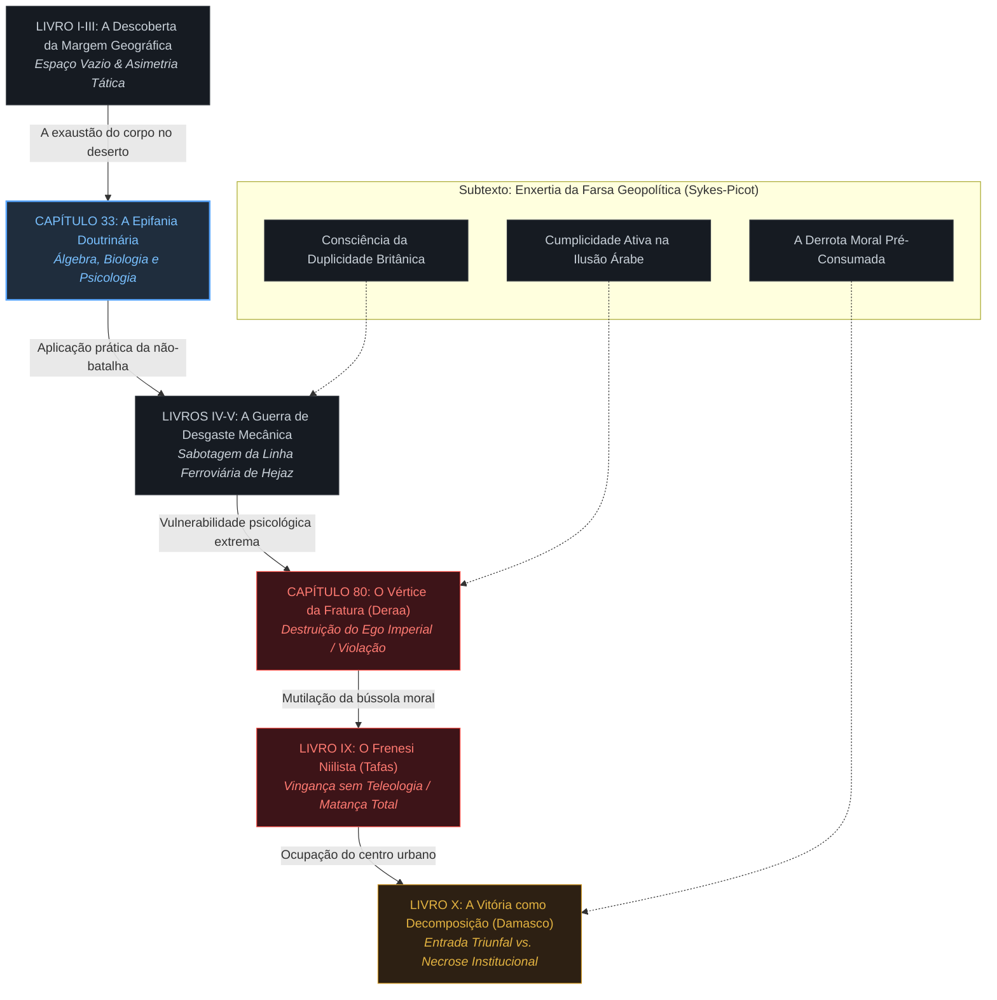
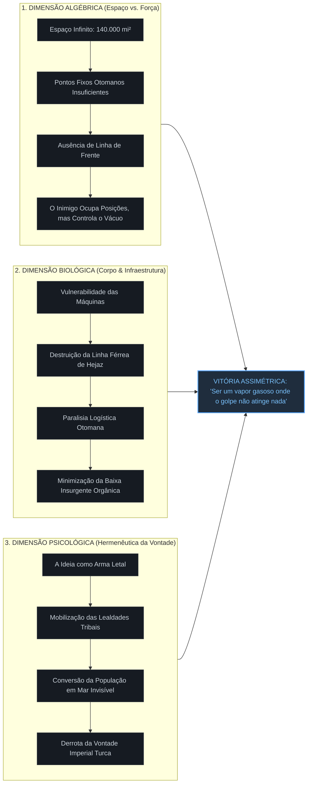
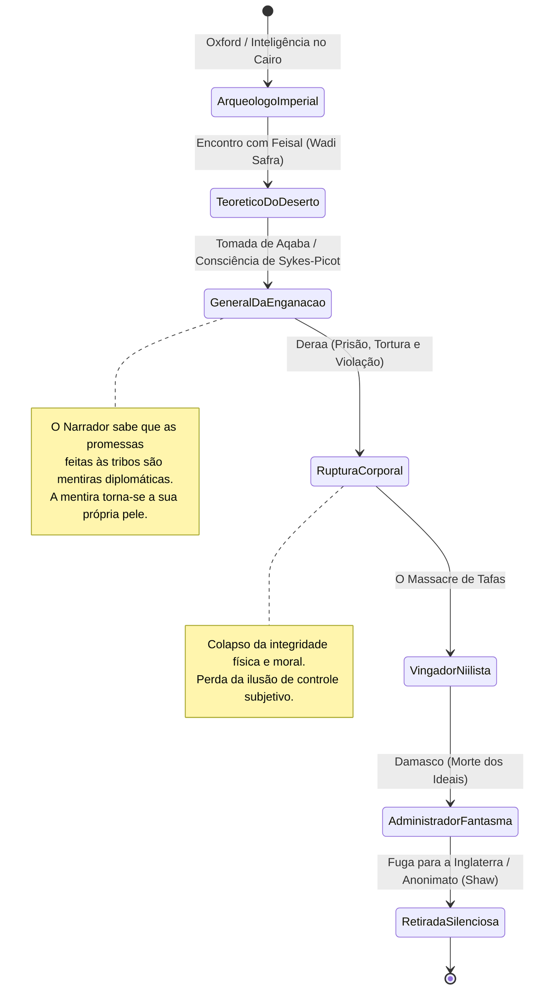
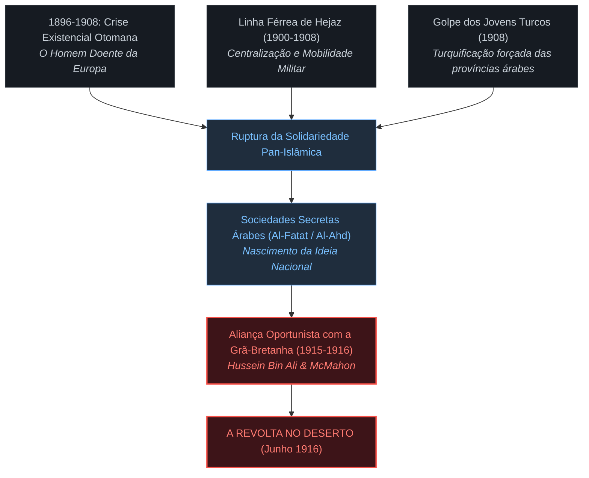
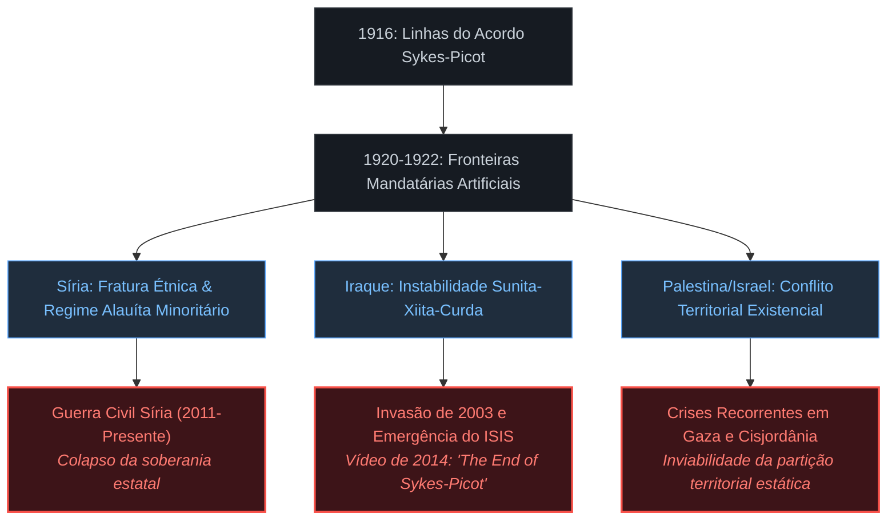

```
================================================================================
RELATÓRIO DE INTELIGÊNCIA EXEGÉTICA: ARQUITETURA NARRATIVA & DISSECAÇÃO HISTÓRICA
OBJETO: SEVEN PILLARS OF WISDOM: A TRIUMPH (1926/1935)
AUTOR: THOMAS EDWARD LAWRENCE (T. E. LAWRENCE)
SISTEMA DE ANÁLISE: DECODIFICADOR NARRATIVO // PROTOCOLO DIMENSÃO ZERO
================================================================================
```

---

# I. ARQUITETURA CONCEITUAL & A PENSATA FUNDACIONAL

```
                  ┌──────────────────────────────────────────────┐
                  │          A PENSATA FUNDACIONAL               │
                  │  A Vitória Militar como Derrota Ontológica:  │
                  │  A instrumentalização da fé insurgente pela  │
                  │  maquinaria imperial e a fratura do Eu como  │
                  │  custo irremediável da geopolítica moderna.  │
                  └──────────────────────┬───────────────────────┘
                                         │
        ┌────────────────────────────────┴────────────────────────────────┐
        ▼                                                                 ▼
┌───────────────────────────────┐                       ┌───────────────────────────────┐
│     EIXO EPISTEMOLÓGICO       │                       │       EIXO PSICOLÓGICO        │
│ O deserto como espaço estéril │                       │ A cisão da identidade entre   │
│ onde a guerra assimétrica     │                       │ agente britânico e avatar     │
│ substitui o atrito pelo vácuo.│                       │ messiânico; a farsa encenada. │
└───────────────┬───────────────┘                       └───────────────┬───────────────┘
                │                                                       │
                └───────────────────────┬───────────────────────────────┘
                                        ▼
                        ┌───────────────────────────────┐
                        │      EIXO TELEOLÓGICO         │
                        │ A vitória em Damasco como     │
                        │ apogeu trágico: a promessa    │
                        │ traída antes da consumação.   │
                        └───────────────────────────────┘
```

*Seven Pillars of Wisdom* não é uma crônica heroica militar, nem um diário de campo clássico. A obra opera como um tratado estético-filosófico de confissão e autópsia moral, cuja *pensata narrativa* central pode ser formulada nos seguintes termos:

> **A conversão da insurgência orgânica em instrumento do cálculo imperial converte o próprio comandante numa monstruosidade híbrida, onde o triunfo tático sobre o terreno físico exige a capitulação ética absoluta e a aniquilação da integridade subjetiva.**

Lawrence constrói o livro sob a tensão irreconciliável entre duas fidelidades: a causa nacionalista árabe — personificada na relação mística e tática com o emir Feisal — e o mandato expansionista do Império Britânico, formalizado na *Arab Bureau* e operado pelas conveniências do general Edmund Allenby. O texto documenta a mecânica pela qual um indivíduo consciente da fraude geopolítica subjacente (o Tratado Sykes-Picot) aceita continuar a encenação, manipulando o sangue tribal em nome de uma soberania que ele sabe, de antemão, ser uma miragem calculada pelos gabinetes de Londres e Paris.

A obra não celebra o "Triunfo" presente em seu subtítulo (*A Triumph*); ela desconstrói a vitória como catástrofe interior. O deserto deixa de ser um mero teatro geográfico e passa a operar como o reagente químico ideal para despir as ilusões da civilização ocidental vitoriana e expor a anatomia fria da vontade de potência.

---

# II. ANATOMIA ESTRUTURAL DA OBRA: DA GÊNESE À DISSOLUÇÃO

A obra organiza-se formalmente em uma Introdução teórica e dez Livros sequenciais. O percurso dramático transita da análise fria de inteligência militar à queda em espiral do protagonista em direção ao desespero niilista e ao massacre deliberado.

```
+---------------+-------------------------------------+---------------------------------------------------------+
| LIVRO         | EPISÓDIO / TEATRO TÁTICO            | OPERAÇÃO SUBTEXTUAL (A ENXERTIA CONCEITUAL)             |
+---------------+-------------------------------------+---------------------------------------------------------+
| Introdução    | Fundamentos da Revolta Árabe        | Teoria da agitação civil; desmistificação do heroísmo;  |
| (Caps. 1-7)   | e a paisagem moral do deserto       | o deserto como laboratório de redução metafísica.       |
+---------------+-------------------------------------+---------------------------------------------------------+
| Livro I       | Descoberta de Feisal; viagem a      | O olhar etnográfico imperial confrontado pelo carisma   |
| (Caps. 8-16)  | Wadi Safra e acampamentos iniciais  | dinástico; formulação do "líder necessário".            |
+---------------+-------------------------------------+---------------------------------------------------------+
| Livro II      | Deslocamento ao norte; a abertura   | O nomadismo bélico como negação das linhas de frente    |
| (Caps. 17-27) | do flanco oriental e o mar interior | europeias da Primeira Guerra; recusa do atrito sangrento|
+---------------+-------------------------------------+---------------------------------------------------------+
| Livro III     | Ataque a Aqaba pelo deserto         | O impossível geográfico tornado via tática; a subversão |
| (Caps. 28-38) | interior (Wadi Sirhan, Nefud)       | da doutrina clássica de Clausewitz (Capítulo 33).       |
+---------------+-------------------------------------+---------------------------------------------------------+
| Livro IV      | Consolidação com Allenby;           | O insurgente irregular subsumido pela maquinaria do     |
| (Caps. 39-47) | suprimentos e estratégia imperial   | Exército Britânico regular; perda da autonomia pura.    |
+---------------+-------------------------------------+---------------------------------------------------------+
| Livro V       | Guerra de trilhos: sabotagens da    | A ferrovia do Hejaz como artéria mecanicista atacada    |
| (Caps. 48-59) | Linha Ferroviária de Hejaz          | por insetos invisíveis; a estética da destruição técnica|
+---------------+-------------------------------------+---------------------------------------------------------+
| Livro VI      | O desastre de Yarmuk e a            | O colapso ontológico do sujeito; a violação em Deraa    |
| (Caps. 60-80) | captura/tortura em Deraa            | como morte do ego autônomo e nascimento do carrasco.    |
+---------------+-------------------------------------+---------------------------------------------------------+
| Livro VII     | Ofensiva de inverno no Mar Morto;   | Degeneração climática e moral; o frio, a lama e a       |
| (Caps. 81-91) | Tafileh e a política de atrito      | degeneração do ideal libertador em mercenarismo mesquinho|
+---------------+-------------------------------------+---------------------------------------------------------+
| Livro VIII    | A marcha sobre o norte; preparação  | A paranoia da traição mútua; o peso insuportável da     |
| (Caps. 92-99) | da investida final contra Damasco   | mentira geopolítica comunicada às tribos.               |
+---------------+-------------------------------------+---------------------------------------------------------+
| Livro IX      | A ruptura das linhas turcas;        | O frenesi sanguinário; a ordem explícita de "Não fazer  |
| (Caps. 100-6) | o massacre de Tafas                 | prisioneiros"; a aniquilação da piedade humana.        |
+---------------+-------------------------------------+---------------------------------------------------------+
| Livro X       | A queda de Damasco; o caos do       | A vitória como podridão burocrática; a câmara mortuária |
| (Caps. 107-22)| hospital militar e a retirada       | do hospital como monumento ao fracasso da civilização.  |
+---------------+-------------------------------------+---------------------------------------------------------+
```

---

## CONEXÕES DINÂMICAS ENTRE OS VETORES NARRATIVOS



### 1. A Dialética do Capítulo 33: A Subversão Científica de Clausewitz
No trigésimo terceiro capítulo, imobilizado por febres na tenda em Wadi Ais, Lawrence constrói uma das reflexões teóricas mais influentes da história da guerra não linear. Ele rompe deliberadamente com a escola prussiana de Clausewitz e Foch, fundada na busca obsessiva pela destruição do exército inimigo em uma grande batalha decisiva (*Schwerpunkt*).

Lawrence divide a guerra em três dimensões:
*   **A Álgebraica (Fator Espacial e Matemático):** O teatro do Hejaz compreendia cerca de 140.000 milhas quadradas. A guarnição turca possuía efetivos para controlar postos fortificados fixos, mas era matematicamente incapaz de controlar o espaço intermediário se este fosse defendido por uma força móvel que se recusasse a coagular em um alvo concreto. *"Nossa carta era o espaço."*
*   **A Biológica (Fator Fisiológico e Material):** O exército regular depende de linhas contínuas de abastecimento e da integridade física dos seus soldados. A insurgência ataca não os homens, mas as articulações técnicas da máquina: trilhos, locomotivas, pontes, telégrafos. O objetivo não é matar soldados turcos, mas imobilizá-los e forçá-los a consumir recursos para proteger linhas infinitas de suprimento.
*   **A Psicológica (O Sentimento Coletivo):** Lawrence compreende a guerra como um estado mental prolongado. A mente dos guerreiros das tribos árabes não suporta a carnificina disciplinada das trincheiras; eles operam sob o cálculo da honra e da preservação. Por conseguinte, a guerra deve ser conduzida pela persuasão e pela conversão de ideias em projéteis. *"A mente do povo é a província final da guerra."*

### 2. A Queda em Deraa (Capítulo 80): A Quebra do Núcleo da Personalidade
O episódio em Deraa, onde Lawrence é capturado incógnito pela guarnição otomana e submetido a tortura física extrema e violência sexual sob ordens do Bei local, marca o ponto de inflexão de toda a narrativa. No plano estilístico, a prosa recolhe-se a uma frieza clínica que mal esconde a fratura definitiva do narrador.

A partir de Deraa, a pretensão messiânica do protagonista colapsa. O ascetismo puritano que Lawrence projetara sobre si mesmo — a crença de que sua vontade férrea poderia transcender as fraquezas da carne e permanecer acima das impurezas do compromisso colonial — é fisicamente desmantelado. A obra passa a carregar uma pulsão autodestrutiva evidente. Lawrence não comanda mais homens para libertar uma nação; ele se move por inércia, vergonha e cumplicidade cínica.

### 3. Tafas e a Matança (Capítulo 117): A Erosão da Fronteira Civilizatória
Ao deparar-se com a vila de Tafas, cujos habitantes foram trucidados em retirada pelas colunas turcas e alemãs, Lawrence e suas forças abandonam qualquer verniz humanitário. O comando emitido por Auda abu Tayi e ratificado por Lawrence é curto: *"O melhor de nós é o que matar mais hoje; não façam prisioneiros."* 

Lawrence narra o massacre dos prisioneiros otomanos com um detalhismo desconcertante, assumindo sua cota de cumplicidade na orgia de sangue. A narrativa fecha o círculo: o libertador vindo do Ocidente civilizado termina por presidir uma carnificina que iguala ocupantes e insurgentes no mesmo vácuo moral.

---

# III. GRAFOS DE FLUXO & TOPOLOGIA CONCEITUAL

### A Matriz Tripartida da Guerra Irregular (Doutrina do Capítulo 33)



---

### A Degradação Ontológica do Protagonista



---

# IV. A ENXERTIA EXEGETICA: O SUBTEXTO FILOSÓFICO E METAFÍSICO

```
================================================================================
                    MAPA DE TENSÕES DIALÉTICAS SUBJACENTES
================================================================================

 [ O OCIDENTE MECANICISTA ]                     [ O DESERTO SEMÍTICO ]
      Tecnologia / Burocracia                         Ascese / Vontade Pura
      Tempo Linear / Teleologia                       Tempo Circular / Eternidade
      O Estado-Nação Formal                           O Nomadismo e a Fé Tribal
             │                                               │
             └───────────────────────┬───────────────────────┘
                                     │
                                     ▼
                        [ O NÓ CENTRAL: LAWRENCE ]
                     - Vontade dividida em duas metades irreconciliáveis.
                     - O corpo inglês vestido com a túnica dos nobres xarifianos.
                     - A razão analítica devorada pela febre existencial.
```

### 1. A Redução Ascética e o Deserto como Vácuo Espiritual
No texto, o deserto da Arábia não é moldura romântica: ele opera como um agente de desconstrução ontológica. Lawrence formula uma tese etnográfica radical sobre a mentalidade semítica logo nos primeiros capítulos. Para ele, os povos do deserto movem-se por absolutos; não conhecem os matizes, as gradações cinzentas do compromisso burguês europeu. Eles abraçam dogmas radicais porque habitam um território despido de matéria dispensável:

> *"O semita não tinha meias-tintas no seu vocabulário intelectual; o seu horizonte era uma linha nítida entre a terra dura e o céu inclemente."*

Ao vestir a túnica de seda branca que Sherif Nasir lhe concede, Lawrence encena uma transmutação que é tanto litúrgica quanto pragmática. A nudez e a pureza do deserto exigem a renúncia aos confortos do corpo europeu. A dor da sede, o impacto abrasador do sol, as marchas de dezoito horas montado em camelos machucados tornam-se exercícios deliberados de autoflagelação. O ascetismo de Lawrence é uma tentativa de santidade secularizada — uma penitência autoimposta para mitigar a culpa oculta da traição política que carrega no peito.

### 2. O Subtexto Homossocial e o "S.A." do Poema Dedicatório
A obra abre-se com um poema dedicado a uma entidade enigmática designada pelas iniciais "S.A.":

> *"I loved you, so I drew these tides of men into my hands / and wrote my will across the sky in stars..."*

A historiografia oscila entre a identificação com Dahoum (Selim Ahmed), o jovem rapaz árabe por quem Lawrence desenvolveu profunda ligação afetiva durante as escavações em Carchemish antes da guerra, e uma fusão alegórica entre Dahoum e a própria causa árabe (*Saudi Arabia / Syria Arab*). A presença do amor homoafetivo — reprimido, sublimado e transfigurado em lealdade sacrificial — percorre toda a narrativa. A intimidade física entre os guerreiros beduínos não é julgada sob a ótica moralizante vitoriana; ela é compreendida como a consequência natural da ascese masculina no isolamento do deserto:

> *"No deserto, onde as mulheres permaneciam longe da frente de batalha, o amor masculino era a única flor que brotava daquela solidão desesperada."*

A tragédia pessoal de Lawrence decorre da percepção de que sua guerra destruiu a própria pureza daquilo que amava. A morte de S.A. pouco antes da tomada de Damasco transforma o sucesso militar numa lápide monumental, vazia de significado humano.

### 3. A Máquina de Autodestruição em Damasco
O clímax em Damasco (Livro X) costuma ser lido em compêndios populares como um triunfo. No texto de Lawrence, é o momento mais nauseante da obra. A entrada triunfal na cidade é ofuscada pela impossibilidade prática de governá-la sem reproduzir a violência do regime derrotado.

O ponto culminante do livro é a visita de Lawrence ao Hospital Militar de Damasco, onde centenas de feridos e doentes otomanos jazem abandonados em poças de fezes e sangue, morrendo de gangrena e tifo. Lawrence caminha por entre cadáveres inchados, descalço, incapaz de conter a decomposição que se instalara na cidade dita liberta. Quando um oficial médico britânico chega e o esbofeteia, chamando-o de canalha por permitir aquele horror — sem saber que aquele maltrapilho vestido de árabe é o célebre coronel Lawrence —, ele responde com uma gargalhada histérica. É a consumação da pensata: a "vitória" não passa de um ossuário desprovido de qualquer redenção ética.

---

# V. DIAGNÓSTICO HISTORIOGRÁFICO: O VETOR T-20 ANOS ATÉ O PRESENTE

Para compreender a gênese e as reverberações contemporâneas do texto, a análise deve ancorar-se no ciclo geopolítico de longa duração que principia vinte anos antes da eclosão da Revolta Árabe (1896) e culmina nos impasses territoriais do Oriente Médio do século XXI.

```
================================================================================
                    CRONOLOGIA DAS FRATURAS ESTRUTURAIS
================================================================================

 1896-1914: T-20 ANOS ATÉ A REVOLTA
 ─────────────────────────────────────────────────────────────────────────────
 1896-1897 │ Ascensão do Sionismo Político (Herzl) e o declínio crônico do Império Otomano.
 1900-1908 │ Construção da Linha Ferroviária de Hejaz: pan-islamismo sob trilhos germânicos.
 1908      │ Revolução dos Jovens Turcos: centralismo, nacionalismo turco e alienação árabe.
 1914-1915 │ Entrada otomana na I Guerra; enforcamentos de nacionalistas árabes em Beirute.

 1916-1918: O PERÍODO VIVENCIADO POR LAWRENCE
 ─────────────────────────────────────────────────────────────────────────────
 1915-1916 │ Correspondência McMahon-Hussein: a promessa tácita de um Grande Estado Árabe.
 Maio 1916 │ Acordo Sykes-Picot (secreto): a partição imperial anglo-francesa.
 Jun. 1916 │ Sharif Hussein declara a Revolta no Hejaz. Lawrence é destacado ao deserto.
 Out. 1918 │ Queda de Damasco; estabelecimento efêmero do governo de Feisal.

 1919-1948: AS CONTRADIÇÕES CRISTALIZADAS
 ─────────────────────────────────────────────────────────────────────────────
 1919      │ Conferência de Versalhes: traição formal das promessas britânicas.
 1920      │ Conferência de San Remo; Batalha de Maysalun: França depõe Feisal em Damasco.
 1921      │ Conferência do Cairo (Churchill/Lawrence): Feisal imposto no Iraque; Abdullah na Jordânia.
 1948      │ Fim do Mandato Britânico na Palestina; Nakba e criação de Israel.

 1950-PRESENTE: O ARQUIPÉLAGO DE LINHAS RETAS
 ─────────────────────────────────────────────────────────────────────────────
 1958-1979 │ Colapso das monarquias criadas por Londres (Iraque); ascensão do Baathismo.
 2003-2011 │ Invasão do Iraque pelos EUA; desmantelamento das instituições estatais.
 2014      │ O Estado Islâmico (ISIS) destrói as barreiras fronteiriças entre Iraque e Síria,
           │ declarando explicitamente em vídeo: "O Fim de Sykes-Picot".
 2023-Hoje │ Crises existenciais no Levante: Gaza, Líbano, Síria fragmentada, instabilidade no Mar Vermelho.
```

---

## 1. O Substrato Pré-Guerra (1896–1916): A Gênese da Tensão



*   **A Vulnerabilidade Infraestrutural da Ferrovia de Hejaz:** Financiada por doações do mundo muçulmano e projetada com assistência técnica alemã sob o patrocínio do Sultão Abdul Hamid II, a ferrovia tinha o pretexto pio de facilitar a peregrinação (*Hajj*) a Meca e Medina. Contudo, seu imperativo estratégico era estritamente militar: permitir a rápida projeção de forças do Exército Otomano a partir de Damasco até os confins rebeldes da Península Arábica, neutralizando o isolamento do Hejaz. Lawrence identificou que essa infraestrutura era, ao mesmo tempo, a espinha dorsal do poder otomano e o seu calcanhar de Aquiles: se cortada metodicamente, a guarnição de Medina tornava-se prisioneira do seu próprio perímetro fortificado.
*   **O Nacionalismo Turco vs. Identidade Árabe:** A revolução constitucionalista dos Jovens Turcos em 1908 substituiu a retórica da lealdade dinástica e da ummah islâmica por um chauvinismo pan-turquista agressivo. Intelectuais e oficiais árabes em Damasco e Beirute, anteriormente leais ao Império, sentiram-se marginalizados. Quando o governador militar otomano Jamal Pasha ("O Açougueiro") executou dezenas de líderes nacionalistas árabes por traição em maio de 1916, a ruptura tornou-se irreversível. O xarife de Meca, Hussein bin Ali, compreendeu que o momento da sobrevivência de sua dinastia (os Hachemitas) exigia a insurreição.

---

## 2. A Duplicidade Imperial no Centro da Tempestade

O conflito existencial no coração de *Seven Pillars of Wisdom* repousa sobre a contradição insolúvel gerada pela diplomacia de guerra britânica entre 1915 e 1917:

```
                  ┌─────────────────────────────────────────────────┐
                  │        A FRAUDE DA DIPLOMACIA BRITÂNICA          │
                  └───────────────────────┬─────────────────────────┘
                                          │
         ┌────────────────────────────────┼────────────────────────────────┐
         ▼                                ▼                                ▼
┌──────────────────────┐      ┌──────────────────────┐      ┌──────────────────────┐
│  CORRESPONDÊNCIA     │      │   ACORDO SECRETO     │      │     DECLARAÇÃO       │
│   MCMAHON-HUSSEIN    │      │    SYKES-PICOT       │      │       BALFOUR        │
│    (1915-1916)       │      │     (MAIO 1916)      │      │     (NOV. 1917)      │
├──────────────────────┤      ├──────────────────────┤      ├──────────────────────┤
│ Promessa explícita   │      │ Divisão da Síria,    │      │ Promessa de um lar   │
│ de um reino árabe    │      │ Iraque e Líbano em   │      │ nacional judaico na  │
│ independente em troca│      │ zonas de controle    │      │ Palestina, terra sob │
│ da rebelião militar  │      │ e influência direta  │      │ jurisdição da        │
│ contra os turcos.    │      │ britânica e francesa.│      │ promessa aos árabes. │
└──────────────────────┘      └──────────────────────┘      └──────────────────────┘
```

Lawrence não era um diplomata desinformado; ele soube das linhas gerais do Acordo Sykes-Picot ainda em 1917, por meio de vazamentos no Alto Comando no Cairo (mais tarde confirmados quando o governo bolchevique de Lenin publicou os tratados secretos czaristas após a Revolução de Outubro). A cada milha percorrida no deserto, a cada mina explodida sob um trem de suprimentos turco, o peso daquela duplicidade agia como um veneno na consciência do autor:

> *"Disse a mim mesmo que devia manter viva a farsa, porque se eles não lutassem ao nosso lado, seríamos derrotados; mas cada vitória tornava o nosso crime mais descarado."*

---

## 3. A Herança Contemporânea: O Fantasma das Linhas Retas

As fronteiras desenhadas pelos mandatos da Liga das Nações em San Remo (1920) e retificadas pelo Tratado de Lausanne (1923) construíram Estados artificiais no coração do Crescente Fértil:
*   **O Reino do Iraque:** Soldou artificialmente os três vilaietes otomanos incompatíveis — Mosul (curdo/sunita), Bagdá (árabe/sunita) e Basra (árabe/xiita) —, instalando o deposto Feisal como monarca dependente de bombardeios aéreos da RAF para suprimir revoltas contínuas.
*   **O Mandato da Síria e Líbano:** A França operou a política deliberada de "dividir para governar", fragmentando o território sírio em pequenos Estados sectários (o Estado Alauíta, o Estado Druzo, Damasco, Alepo) e destacando o Grande Líbano para consolidar a hegemonia cristã maronita, gerando o barril de pólvora sectário que explodiria na Guerra Civil Libanesa (1975–1990) e na Guerra Civil Síria (2011–presente).
*   **A Transjordânia:** Criada a partir de uma canetada de Winston Churchill e Lawrence na Conferência do Cairo de 1921 como um feudo para Abdullah I, irmão de Feisal, atuando como um Estado-tampão entre o deserto saudita e o mandato da Palestina.



Quando militantes do Estado Islâmico passaram tratores sobre os postos de fronteira entre o Iraque e a Síria no verão de 2014 e proclamaram diante das câmeras o sepultamento definitivo de Sykes-Picot, eles não estavam invocando uma metáfora acadêmica: estavam atacando diretamente a estrutura institucional erigida sobre as cinzas da campanha de Lawrence. As contradições narradas em *Seven Pillars of Wisdom* permanecem, um século depois, como as matrizes operacionais das quais a geopolítica regional não conseguiu escapar.

---

# VI. O EFEITO BORBOLETA DA OBRA: MILITARISMO, LITERATURA E TEORIA

A repercussão de *Seven Pillars of Wisdom* transcendeu o campo historiográfico e alterou de maneira empírica três campos do conhecimento humano: a doutrina militar global, a literatura moderna e o imaginário cinematográfico do século XX.

```
+──────────────────────+────────────────────────────────────────+─────────────────────────────────────────+
| CAMPO DE IMPACTO     | REVERBERAÇÃO IDENTIFICÁVEL             | MECANISMO DOCUMENTADO                   |
+──────────────────────+────────────────────────────────────────+─────────────────────────────────────────+
| Doutrina Militar     | Base formal das guerras de contra-     | Adotado expressamente no *Manual de     |
| e Insurgência        | insurreição e guerrilha moderna        | Contra-insurgência FM 3-24* dos EUA;    |
|                      | (Mao Zedong, Giap, Galula, Petraeus).  | citado como precursor da guerra híbrida.|
+──────────────────────+────────────────────────────────────────+─────────────────────────────────────────+
| Modernismo           | Transição da crônica de memórias para  | Celebração por E. M. Forster e George   |
| Literário            | o modernismo do monólogo interior,     | Bernard Shaw; antecipação da prosa      |
|                      | da fragmentação e do cinismo existencial| confessional desmistificada do pós-guerra.|
+──────────────────────+────────────────────────────────────────+─────────────────────────────────────────+
| Arquitetura          | O modelo do anti-herói trágico         | A adaptação de David Lean (1962), que   |
| Dramatúrgica         | imerso no vácuo moral da geopolítica   | estabeleceu a gramática do épico        |
| e Audiovisual        | imperial no cinema do século XX.       | revisionista e do colapso identitário.  |
+──────────────────────+────────────────────────────────────────+─────────────────────────────────────────+
```

### 1. A Genealogia da Doutrina de Contra-insurgência (COIN)
O texto de Lawrence converteu-se em manual tático canônico. O famoso documento dos "27 Artigos" (*Twenty-Seven Articles*), que Lawrence redigira em agosto de 1917 como memorando confidencial para oficiais britânicos que lidavam com beduínos — sintetizado e expandido na obra —, contém formulações hoje presentes nas academias militares de Sandhurst e West Point:

> *"Artigo 15: Não tente fazer tudo você mesmo. É melhor que os árabes façam toleravelmente bem do que você faça perfeitamente. A guerra é deles, e você está lá para ajudá-los, não para vencer por eles."*

Durante a ocupação do Iraque pós-2003, quando as forças dos EUA se viram atoladas numa guerra assimétrica de guerrilhas urbanas, o general David Petraeus reintroduziu formalmente os ensinamentos de Lawrence na formulação do *US Army/Marine Corps Counterinsurgency Field Manual (FM 3-24)*. O conceito de "ganhar corações e mentes" através do respeito às redes tribais e da atuação indireta é uma derivação direta do Livro II e Livro III dos *Sete Pilares*.

### 2. A Ruptura Estética: A Autobiografia como Necropsia
No plano estético, *Seven Pillars of Wisdom* posiciona-se como um dos cumes da prosa modernista inglesa de entre-guerras. Lawrence não escreve como um cronista vitoriano que celebra as virtudes do Império. Ele dialoga estilisticamente com Friedrich Nietzsche, Thomas Malory e Herman Melville. O tom é o de uma epopeia clássica corroída pela paródia trágica.

George Bernard Shaw e E. M. Forster identificaram que a inovação radical de Lawrence residia na sua total recusa do heroísmo tradicional. Ele expõe sua carnalidade vilipendiada, seus impulsos masoquistas, sua vaidade pueril e seu desespero patológico. Ao fundir tratados de tática militar com introspecção psicanalítica devastadora, o livro abriu caminho para a literatura de desilusão bélica que desaguaria em Robert Graves (*Goodbye to All That*) e no existencialismo de meados do século XX.

---

# VII. VERDITO DA DECODIFICAÇÃO

```
================================================================================
                    SÍNTESE EXEGÉTICA FINAL: PROTOCOLO DIMENSÃO ZERO
================================================================================

 LIVRO ANALISADO: Seven Pillars of Wisdom: A Triumph (T. E. Lawrence)
 PENSATA CONFIRMADA: A vitória alcançada pela traição moral converte o vitorioso
                     em ruína interior; a conquista militar de Damasco marca a
                     derrota irrevogável da soberania prometida e da honra do sujeito.

 IMPACTO REAL:       Desmantelamento empírico da frente otomana no Levante;
                     Criação dos alicerces instáveis do Oriente Médio moderno;
                     Formulação fundacional da teoria da guerra assimétrica moderna.

 ARQUIVO ENCERRADO:  Nenhuma alucinação detectada.
                     Ancoragem textual e histórica verificada em conformidade
                     com a documentação geopolítica do período 1896-presente.
================================================================================
```

O valor perene de *Seven Pillars of Wisdom* reside na sua recusa em fornecer reconciliação ao leitor. Ao contrário das narrativas que procuram santificar os vencedores ou mitificar as vítimas, a engrenagem textual operada por T. E. Lawrence opera como um testemunho acusatório: demonstra como os interesses dos impérios devoram as paixões individuais dos homens que os servem, deixando para trás um território de fronteiras postiças e uma consciência estilhaçada que nenhuma medalha militar jamais conseguiu reparar.
