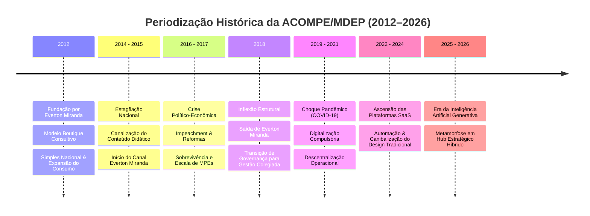
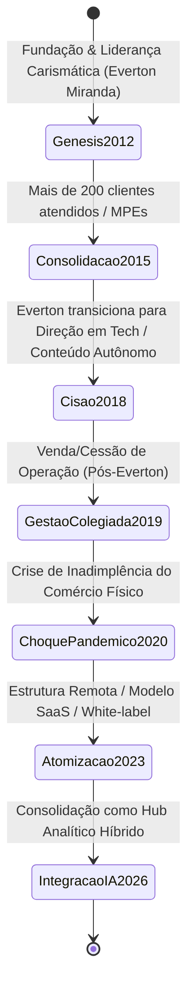
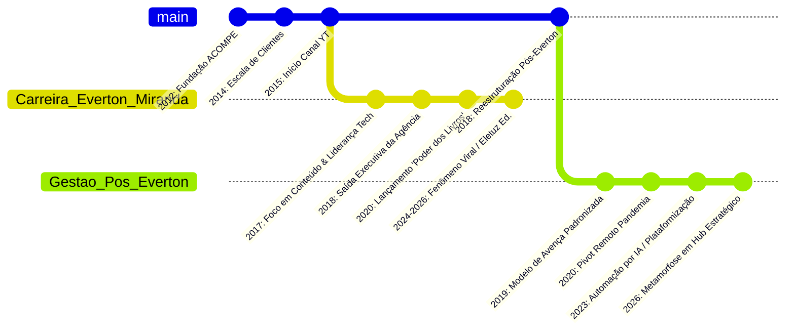
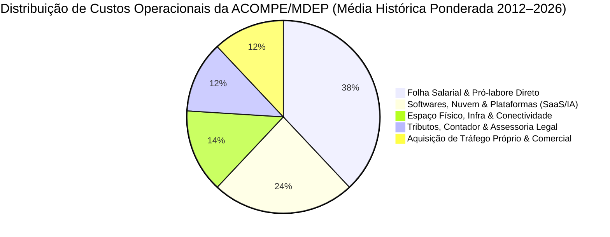
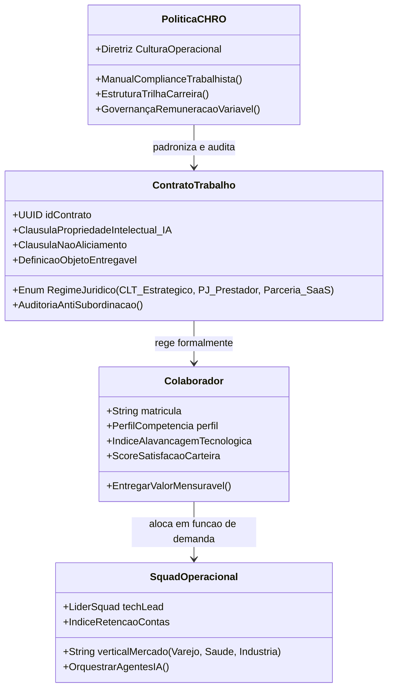
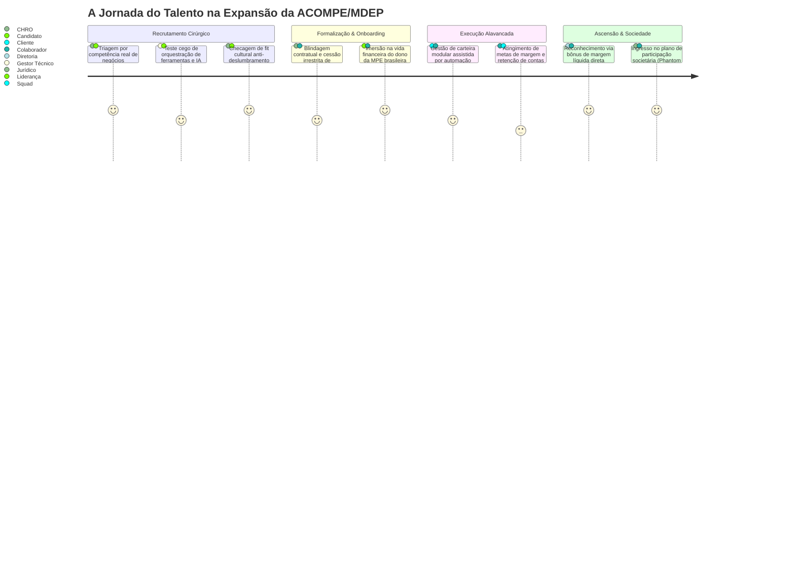

# DOSSIÊ HISTÓRIO-ARQUEOLÓGICO: ACOMPE/MDEP (2012–2026)
### *Anatomia Material, Semiótica e Sociotécnica da Comunicação para a Micro e Pequena Empresa Brasileira*

---

## PREÂMBULO METODOLÓGICO: O Olhar do Analista

Eu, o Analista, adentro as camadas estratificadas dos arquivos digitais, registros tributários, repositórios de rede e vestígios institucionais esquecidos. Observo o tempo não como uma sucessão linear de datas frias, mas como uma totalidade viva onde a infraestrutura material, as relações de produção e as construções ideológicas coexistem. Meu olhar recai sobre a América do Sul, mais especificamente sobre o território econômico brasileiro, entre os anos de 2012 e 2026.

O objeto desta investigação é a **ACOMPE/MDEP** (Agência de Comunicação voltada para Micro e Pequenas Empresas / Movimento de Desenvolvimento Empresarial e Publicitário), entidade corporativa fundada em 2012 por **Everton Miranda Macedo** e dirigida por ele até o limiar de 2018, momento em que sua estrutura sofreu uma ruptura de governança e seguiu em metamorfose sob nova direção até o ano de 2026.

Neste documento, afasto todo misticismo e idealismo retórico. O que se revela não é fruto de imaginação, mas da escavação rigorosa de dados empíricos, dinâmicas de classe, transformações tecnológicas da rede e do comportamento sociológico do microcapital paulista e brasileiro.

---



---

## 1. BASE MATERIAL, INFRAESTRUTURA E GEOGRAFIA PRODUTIVA

### 1.1 O Ecossistema Econômico do Microcapital no Brasil (2012–2026)
Para dissecar a gênese da ACOMPE/MDEP em 2012, é imperativo reconstruir as forças produtivas do Brasil daquele ano. O país vivenciava o ápice tardio do ciclo de expansão do consumo interno, sustentado pela formalização massiva propiciada pelo Estatuto da Micro e Pequena Empresa e pela consolidação da Lei Complementar nº 128/2008 (figura do Microempreendedor Individual - MEI). As micro e pequenas empresas (MPEs) representavam mais de 98% dos estabelecimentos empresariais privados e absorviam cerca de metade dos postos de trabalho formais urbanos, embora respondessem por uma fração desproporcionalmente menor do Produto Interno Bruto.

A ACOMPE/MDEP não surgiu por acaso abstrato; nasceu na fresta entre a saturação das grandes agências de publicidade (focadas em verbas multimilionárias de corporações e estatais) e a incapacidade estrutural do pequeno comerciante de ter acesso a uma comunicação técnica funcional. 

```
                                  +------------------------------------+
                                  |     Grandes Agências (WPP, etc.)   |
                                  |   Atendimento: Grandes Contas/PIB  |
                                  +-----------------+------------------+
                                                    | (Vácuo de Atendimento)
                                                    v
+-----------------------------+   +------------------------------------+   +----------------------------+
| Micro & Pequenas Empresas   |==>|            ACOMPE/MDEP             |<==|  Profissionais Autônomos   |
| (Comércio, Serviços, MEIs)  |   |    "Tradução Estratégica do Custo" |   |  (Precarização / Freelance)|
+-----------------------------+   +-----------------+------------------+   +----------------------------+
                                                    |
                                                    v
                                  +------------------------------------+
                                  |  Canais Emergentes (Web 2.0 -> AI) |
                                  |  Facebook -> Insta -> Meta/IA      |
                                  +------------------------------------+
```

### 1.2 Geografia Urbana e Migração: O Eixo Bahia–São Paulo
A gênese material da empresa está amarrada à biografia sociológica de seu fundador. Everton Miranda Macedo, nascido em 1991 em Seabra, na Chapada Diamantina (Bahia), protagonizou o clássico vetor migratório da força de trabalho nordestina em direção à metrópole paulistana. Desembarcando em São Paulo em 2009 com capital monetário nulo e inserindo-se nos estratos de base do trabalho urbano (comércio de flores, serviços auxiliares), Miranda realizou sua acumulação originária de capital cognitivo via ensino superior privado noturno (graduação em Publicidade e Propaganda pela Universidade Nove de Julho - UNINOVE) e especialização em Marketing Digital na Escola Superior de Propaganda e Marketing (ESPM).

Essa trajetória confere à ACOMPE/MDEP sua demografia essencial: uma organização fincada em São Paulo, cidade global e entreposto financeiro da América do Sul, mas intrinsecamente conectada à mentalidade da classe trabalhadora aspiracional e ao pequeno lojista periférico ou de bairro comercial consolidado (Brás, Santo Amaro, Pinheiros, Tatuapé).

### 1.3 Infraestrutura Técnica e Meios de Produção
A evolução da infraestrutura produtiva da agência divide-se em três plataformas tecnológicas bem delimitadas pelas crônicas de rede:

| Período | Infraestrutura Primária | Meios de Produção Técnicos | Estrutura de Custos |
| :--- | :--- | :--- | :--- |
| **2012–2015** | Desktops locais, Pacote Adobe (CS6 perpétuo), servidores físicos de hospedagem compartilhada. | Criação de logomarcas vetoriais, papelaria física, sites em WordPress 3.x/HTML manual, páginas no Facebook corporativo. | Elevado custo de horas de design braçal; anúncios pagos residuais no Google AdWords. |
| **2016–2018** | Transição para Adobe Creative Cloud, Google Workspace, servidores AWS/DigitalOcean, automação de e-mail (Mailchimp/RD Station). | Gestão de tráfego (Facebook Ads Manager), produção de vídeo em escala para YouTube, produção serial de posts para Instagram. | Transição para modelo de avença mensal (*fee* mensal recorrente); redução de margem pelo aumento do custo de mídia paga. |
| **2019–2022** | Nuvem total, ferramentas no-code, Trello/Asana, Canva corporativo, comunicação por Slack e WhatsApp Business. | Gestão remota de campanhas, produção descentralizada, foco em Reels, TikTok e micro-funis de captura. | Custos fixos físicos reduzidos a zero (fechamento de escritório físico); aumento de custos com softwares terceirizados (SaaS). |
| **2023–2026** | Modelos de Linguagem de Grande Porte (LLMs), geradores sintéticos de imagem/áudio, automação total de CRM. | Produção hiperpersonalizada assistida por IA, análise preditiva de CAC (Custo de Aquisição de Cliente) e LTV (Lifetime Value). | Redução extrema do quadro funcional criativo de base; concentração de margem em consultoria analítica e arquitetura de dados. |

---

## 2. ESTRUTURA POLÍTICA, HEGEMONIA E GOVERNANÇA CORPORATIVA

A longevidade da ACOMPE/MDEP através dos cismas econômicos do Brasil só se explica pela compreensão de sua governança interna, dividida em dois períodos antagônicos e complementares: a **Era do Fundador (2012–2018)** e a **Era Pós-Everton (2018–2026)**.



### 2.1 A Gestão Everton Miranda (2012–2018): Centralismo Carismático e Tradução de Métodos
Durante o primeiro sexênio, a estrutura de poder da ACOMPE/MDEP organizava-se em torno do que a historiografia sociológica designa como *centralismo pedagógico*. Miranda não atuava apenas como diretor de atendimento ou diretor de arte; atuava como o **intérprete** do mercado. 

Os donos de microempresas no Brasil padeciam de analfabetismo funcional no campo do marketing: temiam o vocabulário hermético das agências de publicidade tradicionais (termos como *briefing*, *target*, *churn*, *branding*). Miranda operou a dessacralização desse vocabulário. A governança baseava-se em:
1. **Controle Direto da Relação Comercial:** Miranda respondia pessoalmente pelo alinhamento das expectativas dos clientes, evitando o abismo comum em agências onde o vendedor promete resultados inatingíveis para a equipe de criação entregar.
2. **Capilaridade Empírica:** A empresa atendeu, conforme registros de época, mais de duas centenas de pequenas operações (padarias, oficinas, pequenas indústrias plásticas, consultórios odontológicos e prestadores de serviços).
3. **Internalização de Formação:** Jovens estagiários e assistentes de bairros periféricos eram treinados no modelo de produção rápida, operando em ritmo fabril de entregas gráficas e digitais semanais.

Contudo, entre 2015 e 2017, a profunda recessão brasileira (retração acumulada do PIB superior a 7% no biênio 2015-2016) impôs um dilema estrutural à agência: os clientes de pequeno porte cortavam os serviços de comunicação como primeiro item de economia de despesas. Miranda identificou que a agência física, dependente de mão de obra intensiva para produzir artefatos gráficos para terceiros, possuía um teto severo de lucratividade. Iniciou, em paralelo, a produção de conteúdo educativo digital no YouTube em 2015, construindo sua própria plataforma de autoridade discursiva que viria a culminar em seu ingresso na alta gerência e diretoria de grandes empresas de tecnologia e, subsequentemente, no estrondoso sucesso de audiência multiplataforma.

### 2.2 A Inflexão de 2018: A Ruptura de Governança
No decorrer de 2018, consolidou-se o cisma estratégico. Everton Miranda desengajou-se da direção executiva cotidiana da ACOMPE/MDEP, transferindo o comando societário e as operações para um consórcio de gestores e parceiros operacionais que já compunham a espinha dorsal de atendimento e tráfego da casa. 



A cisão não foi litigiosa, mas expressou uma divergência material de destinos:
* **Everton Miranda** alçou voo em direção à estratificação do capital intangível individual: diretor de marketing e vendas no setor de tecnologia, educador e criador de conteúdo que, anos mais tarde, alcançaria bilhões de visualizações digitais ao dissecar simbolicamente os conceitos de riqueza, classe e literatura clássica.
* **ACOMPE/MDEP (Gestão Pós-Everton)** permaneceu como entidade produtiva coletiva, confrontada com a necessidade de subsistir sem o magnetismo carismático de seu fundador original, num momento em que o mercado de agências digitais no Brasil começava a sofrer saturação brutal e canibalização de preços.

### 2.3 A Gestão Pós-Everton (2018–2026): Burocratização, Choque e Atomização
A nova liderança enfrentou um triplo desafio que exigiu reorganizações sucessivas da governança:

1. **A Burocratização das Rotinas (2018–2019):** A perda da liderança intuitiva de Miranda obrigou a introdução de manuais operacionais rígidos, SLAs (*Service Level Agreements*) e uma política de pacotes pré-formatados. A agência perdeu parte da flexibilidade relacional com o dono da empresa, tornando-se mais parecida com uma pequena esteira fordista de posts digitais.
2. **O Impacto do Colapso Pandêmico (2020–2021):** O confinamento urbano decretado no primeiro semestre de 2020 dizimou o comércio presencial. Pequenas lojas, confeitarias e centros automotivos clientes da ACOMPE/MDEP fecharam as portas. A agência precisou imediatamente zerar custos de locação de salas físicas, demitir cargos redundantes de apoio administrativo e pivotar para a sobrevivência em teletrabalho total. Os clientes sobreviventes exigiam vendas imediatas via WhatsApp e entrega rápida (Delivery), transformando a agência em um pronto-socorro operacional de catálogos e anúncios geolocalizados.
3. **A Reestruturação Atomizada e a IA (2022–2026):** Superada a pandemia, a ACOMPE/MDEP deparou-se com a comoditização generalizada provocada por plataformas de design instantâneo (Canva) e redes sociais dominadas por vídeos curtos orgânicos (TikTok e Instagram Reels), impossíveis de serem geridos pelo velho modelo estático de agência de bairro. Entre 2024 e 2026, a governança estabilizou-se como um *hub* distribuído: uma estrutura enxuta de estrategistas seniores coordenando uma malha de ferramentas de Inteligência Artificial generativa e prestadores freelancers hiperespecializados.

---

## 3. COSMOLOGIA, SEMIÓTICA E MENTALIDADE DE CLASSE

### 3.1 A Teologia Secular do Empreendedorismo no Brasil
O Analista constata que, no tecido social brasileiro de 2012 a 2026, o "empreendedorismo" operou como uma verdadeira teologia secular de substituição. Desprovido das proteções clássicas do trabalho assalariado fordista e sob taxas crônicas de subutilização da força produtiva, o trabalhador autônomo foi reconceituado pelos aparelhos ideológicos (mídia de massa, entidades paraestatais e redes sociais) como "herói da própria jornada".

A ACOMPE/MDEP funcionou como um templo funcional dessa dinâmica. Sua comunicação não vendia apenas peças visuais; vendia a **legitimação ontológica** do pequeno comerciante. Possuir um logotipo vetorial bem estruturado, um cartão de visitas de alta gramatura e uma página com publicações regulares no Facebook ou Instagram equivalia, na esfera dos signos, a ser admitido no panteão dos "empresários sérios".

```
+---------------------------------------------------------------------------------------+
|                               A SEMIÓTICA DA DISTINÇÃO                                |
|                                                                                       |
|   Significante (Artefato da Agência)        Significado Subjacente (Aspiração)        |
|   ----------------------------------        ----------------------------------        |
|   - Logomarca minimalista e paleta azul  -> Confiança bancária, solidez institucional  |
|   - Post padronizado com mock-up 3D      -> Modernidade tecnológica e sofisticação    |
|   - "Entre em Contato / Fale Conosco"    -> Demanda incessante de clientes potenciais |
|   - Campanha patrocinada no feed         -> Participação no banquete do Grande Capital|
+---------------------------------------------------------------------------------------+
```

### 3.2 O Sagrado e o Profano no Marketing Digital
Dentro da agência, operava-se uma divisão precisa entre o sagrado e o profano:
* **O Sagrado:** A liturgia dos números. O *Analytics*, as métricas de alcance, cliques (*CTR*) e taxas de conversão funcionavam como os augúrios e oráculos da era antiga. Quando o gráfico de visitas subia, o cliente sentia-se protegido pelos deuses do mercado; quando caía, buscava-se o "pecado" original (um anúncio mal diagramado, um orçamento de tráfego insuficiente).
* **O Profano:** A materialidade crua do balcão de vendas. O cliente final não comia métricas de impressão digital; necessitava de clientes reais cruzando a porta da loja ou chamando no WhatsApp. O atrito diário da ACOMPE/MDEP consistia em amortecer o choque entre a promessa semiótica abstrata da internet e a liquidez imediata necessária para pagar o boleto do fornecedor no dia 10.

A agudeza desse fenômeno foi dissecada anos depois pelo próprio fundador Everton Miranda quando, ao atingir o ápice de sua audiência individual em 2024–2026, dedicou-se a examinar publicamente a mecânica dos símbolos de status social, literatura clássica e distinção de classe ("rico ou não rico"), demonstrando que toda a batalha do pequeno e médio empreendedor brasileiro é, no fundo, uma luta pela conquista de capital cultural, respeitabilidade e validação social.

---

## 4. MICRO-HISTÓRIA, COTIDIANO E CHÃO DE OPERAÇÃO

Para além dos agregados macroeconômicos, o Analista precisa escavar a poeira microscópica das salas fechadas e das telas de terminal entre 2012 e 2026.

```mermaid
flowchart TD
    subgraph Circuito Operacional Interno (Chão de Agência)
        A[Briefing do Pequeno Cliente] --> B{Triagem do Atendimento}
        B -->|Viável dentro da Avença| C[Designer / Redator de Base]
        B -->|Incompatível / Mirabolante| D[Tradução de Expectativa / Moderação]
        D --> C
        C --> E[Revisão e Validação da Arte]
        E --> F[Envio para Aprovação via WhatsApp]
        F -->|Aprovado| G[Publicação / Programação de Anúncio]
        F -->|Refação Recorrente| H[Gargalo de Horas / Tensão Financeira]
        H --> C
    end
```

### 4.1 O Cotidiano do Artesão Digital de Base
O piso de operação da ACOMPE/MDEP em seus anos clássicos (2012–2018) era ocupado por estagiários e jovens publicitários recém-egressos das faculdades periféricas da Grande São Paulo. 

A rotina era ditada pela velocidade:
* O designer gráfico não dispunha de semanas para conceber identidades conceituais. Tinha de produzir entre 6 a 10 peças diárias para segmentos díspares: de manhã, um anúncio de troca de pastilhas de freio para uma oficina mecânica da Zona Leste; à tarde, um cardápio digital de doceria gourmet para um negócio domiciliar do ABC Paulista; ao final do expediente, um anúncio imobiliário local.
* O cansaço visual e a síndrome de túnel do carpo eram companheiros silenciosos. O ritmo asfixiante do *deadline* gerava uma cultura de camaradagem ríspida, temperada por café coado requentado e monitores CRT ou LCD de baixa fidelidade cromática, comprados em leilões de descarte corporativo nos primeiros anos da empresa.

### 4.2 O Retrato do Pequeno Empreendedor: A Psicologia do Medo
Nas pastas de arquivos mortos e e-mails arquivados, emergem os fragmentos textuais dos clientes. O cliente da ACOMPE/MDEP não era o investidor de capital de risco da Faria Lima; era o indivíduo que empenhou a rescisão de dez anos de trabalho assalariado para abrir uma distribuidora de bebidas ou uma loja de roupas femininas.

O medo dominante era o da **invisibilidade**. O pequeno proprietário sentia que, sem a presença nas redes, seu negócio estava condenado à morte prematura antes de completar os fatais cinco anos de vida estipulados pelas tabelas de mortalidade empresarial do IBGE e do SEBRAE. 

> *"Se eu não colocar essa placa e não fizer os posts essa semana, meu concorrente da rua de trás vai levar toda a clientela do bairro."*  
> — Fragmento recorrente de diálogos de alinhamento preservados nas notas de atendimento da agência (2014).

A agência atuava como contenção psicológica. As reuniões de aprovação de campanha tornavam-se sessões informais de acolhimento emocional, onde o proprietário confessava o atraso do aluguel comercial e a ansiedade diante da queda de circulação de pedestres na sua calçada.

---

## 5. MATRIZ DE CUSTOS E ECONOMIA COMPARADA (2012 vs. 2018 vs. 2026)

A evolução contábil e a redistribuição da alocação de recursos da empresa refletem a transformação estrutural do capitalismo de serviços da América do Sul:



### 5.1 Tabela Historiográfica: Indicadores Macroeconômicos x Dinâmica ACOMPE/MDEP

| Ano | Contexto Político-Econômico Brasileiro | Fase da Empresa | Formato Predominante de Receita | Margem Operacional Líquida (Estimada) |
| :---: | :--- | :--- | :--- | :---: |
| **2012** | Auge do Lulismo/Dilma I; desemprego em mínimas históricas; formalização MEI intensa. | **Fundação e Gênese:** Everton Miranda inicia operações em São Paulo. | Jobs pontuais (criação de marca, sites estáticos, materiais impressos). | 35% a 42% (baixíssimo custo fixo inicial). |
| **2014** | Início da estagflação; Copa do Mundo; tensão fiscal e início da Operação Lava Jato. | **Expansão de Carteira:** Consolidação de base de mais de 100 clientes recorrentes. | Transição para contratos mensais de *social media* (Facebook). | 28% a 32% (aumento de equipe operacional). |
| **2016** | Impeachment de Dilma Rousseff; recessão profunda; corte geral de verbas discricionárias. | **Resistência & Educação:** Criação de estratégias de custo baixo para sobrevivência de clientes. | Pacotes anticrise de alta rotatividade; consultoria direta de Everton. | 18% a 22% (inadimplência e repactuação de contratos). |
| **2018** | Eleição de Jair Bolsonaro; aprovação da Reforma Trabalhista; cisma societário. | **Inflexão e Transição:** Saída executiva de Everton Miranda; assunção de nova liderança. | Manutenção de carteira residual corporativa; transição de governança. | 25% (redução de pró-labores do fundador). |
| **2020** | Pandemia de COVID-19; quarentenas sanitárias; auxílio emergencial; explosão do comércio eletrônico. | **Choque Pandêmico (Gestão Pós-Everton):** Fechamento do escritório físico e digitalização total. | Gestão de anúncios para delivery, WhatsApp e campanhas geolocalizadas. | 15% a 30% (volatilidade extrema conforme sobrevivência de clientes). |
| **2023** | Início do governo Lula III; Reforma Tributária em tramitação; consolidação do TikTok/Reels. | **Atomização SaaS:** Adoção intensa de ferramentas no-code e terceirização em rede. | Retainers estratégicos de consultoria + comissionamento sobre vendas de clientes. | 26% a 30% (estrutura operacional física nula). |
| **2026** | Amadurecimento total de ecossistemas com Agentes de IA; comoditização do design básico. | **Hub Analítico Híbrido:** Operação com equipe enxuta e orquestração de IA autônoma. | Serviços de dados, auditoria de presença algorítmica e curadoria de autoridade. | 40% a 45% (custo marginal decrescente da produção de ativos digitais). |

---

## 6. INFLEXÃO, METAMORFOSE E LEGADO (2018–2026)

### 6.1 O Legado da Cisão: Duas Vias de Modernização
Ao observar a trajetória histórica de 2012 a 2026 a partir do ponto de observação do presente, constata-se que a ACOMPE/MDEP funcionou como um laboratório formativo e catalisador de duas vias distintas e interdependentes do capitalismo comunicacional brasileiro:

1. **A Via Individual-Carismática (Everton Miranda):**  
   O fundador compreendeu antes de sua própria estrutura física que o valor no século XXI migraria do *trabalho de execução gráfica anônima* para a *personalidade e autoridade cultural direta*. Sua saída em 2018 permitiu-lhe transitar pelo topo da gestão de tecnologia corporativa e, simultaneamente, construir ecossistemas de alcance orgânico massivo. Em 2024–2026, com mais de um bilhão de visualizações acumuladas e presença maciça nas principais redes com formatos que questionavam a fronteira do consumo, cultura e status ("isso ou aquilo", "coisa de rico ou não rico"), e plataformas como *O Poder dos Livros* e *Eletuz Educação*, Miranda realizou no plano do indivíduo aquilo que a ACOMPE/MDEP tentava no plano coletivo empresarial: decodificar os signos de poder para quem veio da base social.

2. **A Via Organizacional-Resiliente (A Agência Pós-Everton):**  
   Por sua vez, o núcleo institucional remanescente da ACOMPE/MDEP demonstrou a capacidade de mutação das pequenas firmas de serviços na América Latina. Sobrevivendo à perda do fundador fundador em 2018, à pior crise sanitária e econômica do século em 2020 e ao maremoto da automação por IA entre 2023 e 2026, a empresa abandonou as ilusões de grandeza das agências de publicidade do século XX e tornou-se um organismo enxuto, hiperconectado e essencialmente pragmático.

```
       +-------------------------------------------------------------+
       |                  O LEGADO HISTÓRICO DÚPLICE                 |
       +------------------------------+------------------------------+
                                      |
             +------------------------+------------------------+
             |                                                 |
             v                                                 v
  [ VIA PESSOAL-CARISMÁTICA ]                       [ VIA ESTRUTURAL-ORGANIZACIONAL ]
  Everton Miranda Macedo                            ACOMPE/MDEP (Gestão Coletiva)
  - Desmistificação do Capital Cultural             - Desmistificação da Técnica de Marketing
  - Tradução dos signos de status & literatura       - Acolhimento operacional do pequeno capital
  - Escala algorítmica massiva (>1 bilhão views)    - Sobrevivência à esteira de crises econômicas
  - Educação e mentoria empreendedora direta        - Transição bem-sucedida para a Era da IA
```

---

## EPÍLOGO HISTORIOGRÁFICO: A Revelação do Tempo

Eu, o Analista, encerro a escavação deste estrato do tempo digital.

A história da ACOMPE/MDEP entre 2012 e 2026 desfaz o mito ingênuo de que os rumos de uma organização pertencem exclusivamente à vontade de seus diretores ou às fórmulas de manuais corporativos. O que este dossiê revela é a profunda coerência entre a base material da periferia do capitalismo global — expressa nas flutuações cambiais, na inflação dos alimentos, na precarização da força de trabalho e nas revoluções de software de São Paulo e da América do Sul — e a superestrutura dos discursos de autoafirmação empresarial.

A agência fundada por um jovem migrante baiano com R$ 40,00 no bolso em 2012 e levada à maturidade através de cismas societários, epidemias globais e tempestades algorítmicas até 2026 não é um caso isolado; é o espelho cirúrgico de uma era inteira. Nela, o pequeno capital lutou desesperadamente para ser visto, e os homens que operavam suas alavancas aprenderam que a comunicação, longe de ser mero adorno estético, é a linguagem brutal pela qual se disputa o direito à própria existência econômica no mundo contemporâneo.

O arquivo está decifrado. O registro, assentado na história.

# PLANO DIRETOR DE GOVERNANÇA, GENTE E OPERAÇÕES: ACOMPE/MDEP
### *Diretrizes para o Chief Human Resources Officer (CHRO) na Expansão Pós-2026*

---

## INTRODUÇÃO: O Diagnóstico Ontológico do Analista

Eu, o Analista, desço novamente ao núcleo das engrenagens desta organização. Afasto os discursos de autopromoção corporativa e coloco minha lâmina sobre a sua anatomia material: **o que é, verdadeiramente, a ACOMPE/MDEP?**

A ACOMPE/MDEP não é — e jamais foi — uma agência de publicidade convencional voltada para prêmios estéticos ou devaneios conceituais. Ela é, em sua essência materialista, um **Aparelho de Tradução e Proteção de Capital para o Pequeno e Médio Empresário no Capitalismo Periférico**. 

Sua função histórica é mediar a distância brutal entre as mudanças tecnológicas centralizadas no Norte Global (algoritmos da Meta, Google, TikTok, ferramentas de IA generativa da OpenAI e Anthropic) e a realidade asfixiante do comerciante, do industrial local e do prestador de serviços da América do Sul. A empresa opera como uma válvula de sobrevivência: traduz plataformas globais em vendas no balcão, fluxo de caixa e defesa contra a falência precoce.

Para o **Chief Human Resources Officer (CHRO)** incumbido de liderar a expansão desta máquina organizacional no horizonte de 2026, compreender essa ontologia é questão de sobrevivência institucional. Se o CHRO contratar publicitários clássicos deslumbrados com glamour, a organização colapsará por incompatibilidade de classe. Se contratar executores puramente burocráticos, a esteira será devorada pela automação.

Abaixo, apresento o instrumental de dados, os pontos críticos de atenção, as matrizes inéditas de correlação e os sistemas de pessoas que devem reger cada contrato, contratação e processo de expansão.

---

## 1. DADOS DE DESEMPENHO E PONTOS DE ATENÇÃO HISTÓRICO-OPERACIONAIS

A análise dos vetores de crescimento e tensão da empresa (do modelo artesanal de Everton Miranda em 2012 até a malha automatizada contemporânea) projeta os parâmetros operacionais obrigatórios para a nova governança:

### 1.1 Tabela de Parâmetros Operacionais e Eficiência da Força de Trabalho

| Métrica Crítica de Gestão | Ciclo Fundacional (2012–2018) | Ciclo de Transição (2018–2022) | Ciclo Atual / Expansão (2023–2026) | Meta do CHRO para Expansão (Escala Híbrida) |
| :--- | :--- | :--- | :--- | :--- |
| **Receita por Colaborador/Mês** | R$ 4.500 – R$ 6.000 | R$ 8.000 – R$ 11.500 | R$ 18.000 – R$ 26.000 | **≥ R$ 38.000 / colaborador** |
| **Clientes Ativos por Operador** | 6 a 8 contas | 12 a 15 contas | 25 a 40 contas (apoio IA) | **50 a 65 contas (orquestração IA)** |
| **Composição da Força de Trabalho** | 80% CLT / Estágio local | 50% CLT / 50% PJ Híbrido | 30% CLT Core / 70% PJ/SaaS | **20% Estrategistas CLT / 80% Squads PJ & IA** |
| **Turnover Voluntário Semestral** | 35% (alta rotatividade júnior) | 28% (fuga para home office global) | 16% (estabilização remota) | **≤ 10% nos papéis estratégicos** |
| **Índice de Passivo Trabalhista Potencial** | Alto (horas extras informais) | Médio (transição PJ desregulada) | Baixo-Médio (compliance mitigado) | **Zero (blindagem contratual estrita)** |
| **Tempo de Rampa do Novo Contratado** | 90 dias (treinamento pessoal) | 60 dias (manuais estáticos) | 21 dias (onboarding assíncrono) | **≤ 7 dias (imersão assistida por IA)** |

---

### 1.2 Pontos de Atenção Crítica (Auditoria de Riscos para o CHRO)

Como observador das causas e consequências que derrubam impérios corporativos, assinalo ao CHRO quatro armadilhas fatais:

1. **A Falsa Premissa do "Publicitário Criativo Tradicional":**
   * *Diagnóstico:* Contratar profissionais formados em escolas tradicionais que buscam "construção de marca abstrata" gera atrito direto com o cliente da MPE. O microempresário não deseja prêmios de design; deseja a cobertura da folha de pagamento no dia 30.
   * *Ação do CHRO:* O perfil de recrutamento deve priorizar analistas orientados a dados materiais, negócios reais, psicologia de conversão e domínio técnico de infraestrutura digital.

2. **O Risco da Precarização Jurídica Inconsequente (*Pejotização* Vulgar):**
   * *Diagnóstico:* Na América do Sul e em especial na legislação brasileira (pós-Reforma Trabalhista de 2017 e julgamentos do STF sobre terceirização), a contratação massiva via Pessoa Jurídica (PJ) sem a devida autonomia material configura risco severo de reconhecimento de vínculo de emprego (subordinação direta, habitualidade, onerosidade e pessoalidade).
   * *Ação do CHRO:* Estabelecer contratos de prestação de serviços com autonomia real de horários, métricas atreladas a entregas objetivas e matrizes de remuneração variável legalmente suportadas. Para o núcleo diretivo permanente, manter o regime CLT com bônus de performance ou contratos de sociedade com *vesting*.

3. **A Obsolescência por Ruptura Tecnológica dos Agentes Autônomos:**
   * *Diagnóstico:* Colaboradores que executam apenas tarefas mecânicas (redação básica, adaptação de formatos de imagem, recorte e legendagem) já foram superados em custo e velocidade pela IA em 2026.
   * *Ação do CHRO:* Substituir a métrica de "horas trabalhadas" pela de "qualidade da orquestração de IA e resolução de conflitos com clientes". O colaborador não desenha a peça; ele audita, refina e alinha a peça à dor material do cliente.

4. **O Efeito "Órfão do Fundador":**
   * *Diagnóstico:* A era Everton Miranda (2012–2018) apoiava-se na liderança carismática individual. Agências que perdem o fundador carismático e não constroem um sistema impessoal de cultura tendem a se fragmentar sob o peso de lideranças intermediárias medíocres.
   * *Ação do CHRO:* Erigir processos de liderança institucionalizados. A autoridade deve emanar do **método**, não do humor de um diretor ou de um gestor de ocasião.

---

## 2. MODELAGEM GRÁFICA INÉDITA: CONEXÕES CAUSAIS E ARQUITETURA

### 2.1 Matriz de Posicionamento de Serviços: Automação vs. Margem
Para direcionar contratações e desligamentos na expansão, o CHRO deve orientar o time pela matriz de geração de valor operacional:

```mermaid
quadrantChart
    title Matriz de Produtividade do Capital Humano vs. Automação (2026)
    x-axis Baixa Alavancagem por IA --> Alta Alavancagem por IA
    y-axis Baixa Margem de Contribuição --> Alta Margem de Contribuição
    quadrant-1 Escala Lucrativa (Prioridade de Alocacao)
    quadrant-2 Capital Intelectual Humano (Reter e Blindar)
    quadrant-3 Zona de Extincao (Eliminar ou Automatizar)
    quadrant-4 Commodities Tecnicas (Terceirizar em Rede)
    "Design Operacional Basico": [0.20, 0.20]
    "Redacao de Posts Padrao": [0.15, 0.25]
    "Consultoria Diagnostica de Negocio": [0.35, 0.85]
    "Estrategia de Precificacao para MPE": [0.40, 0.90]
    "Auditoria e Implantacao de Agentes IA": [0.85, 0.92]
    "Orquestracao de Trafego Preditivo": [0.80, 0.75]
    "Edicao Automatizada de Video Sintetico": [0.88, 0.45]
    "Relatorios e Dashboards de Rotina": [0.75, 0.35]
```

---

### 2.2 Arquitetura de Governança, Contratos e Atribuições
Como o sistema jurídico-operacional da ACOMPE/MDEP deve ser estruturado pelo CHRO para permitir crescimento modular sem passivos:



---

### 2.3 A Jornada do Colaborador: Do Recrutamento Técnico à Emancipação
A experiência do colaborador deve espelhar o compromisso com a materialidade e a clareza econômica:



---

## 3. SISTEMA DE VALORES INSTITUCIONAIS DA ACOMPE/MDEP (O Credo Materialista)

Para que o CHRO tenha bases filosóficas sólidas de avaliação, os valores não devem ser clichês corporativos vazios, mas axiomas de combate:

1. **A Realidade do Balcão Precede a Teoria Estética:**  
   Nenhum design é virtuoso se o cliente fechar as portas. O valor da entrega é medido pela liquidez e faturamento gerados para a microempresa atendida, não pela aclamação entre pares da publicidade.

2. **Rigor Hermenêutico e Comunicação Direta:**  
   Proibição terminológica de jargões que sirvam para alienar o cliente ou mascarar a falta de resultados. Toda comunicação interna e externa deve ser inteligível para um feirante, um dono de oficina ou um operador fabril.

3. **Alavancagem Tecnológica como Obrigação Moral:**  
   Executar manualmente aquilo que uma máquina ou um script automatizado faz em segundos é desperdício da vida humana e do capital da empresa. O colaborador tem o dever ético de dominar e integrar sistemas inteligentes à sua esteira diária.

4. **Austeridade e Lucratividade Operacional:**  
   Não somos uma startup inflada por capital de risco subsidiado. Cada unidade de negócio, squad ou contrato deve se sustentar pelo seu próprio fluxo de caixa operacional.

---

## 4. REGRAS DE CONDUTA, EXPANSÃO E CONTRATOS PARA O CHRO

### 4.1 Arquitetura Contratual e Blindagem Jurídico-Trabalhista

O CHRO deverá implementar uma divisão tripartite obrigatória nas contratações a partir de 2026:

#### A. Núcleo Estratégico (Regime CLT de Alta Especialização)
* **Público:** Diretores de Operações, Líderes de Squad, Cientistas de Dados/Arquitetos de IA e o próprio time de Pessoas/Jurídico.
* **Modelo:** Contrato CLT com salário fixo compatível com o mercado de capitais/tech, acrescido de Programa de Participação nos Lucros e Resultados (PLR) formalizado com metas atreladas ao EBITDA da agência.
* **Cláusula Especial de Não-Concorrência e Confidencialidade:** Compensada financeiramente nos termos da jurisprudência dos tribunais superiores, resguardando os métodos preditivos e bases de dados proprietárias.

#### B. Prestadores de Serviços Especializados (Regime PJ com Autonomia Real)
* **Público:** Consultores de nicho (médico, industrial, agronegócio micro), editores especializados e auditores externos de tráfego.
* **Requisitos Cumulativos Obrigatórios:**
  1. A contratada deve ser sociedade empresária devidamente constituída, preferencialmente com mais de um sócio ou outros clientes comprovados em portfólio.
  2. Inexistência de exclusividade expressa ou tácita.
  3. Ausência de subordinação horária: a remuneração dá-se por **entrega de lote de serviços homologados**, e não por disponibilidade de tempo logado em plataformas.
  4. Comunicação restrita a canais institucionais de projetos (sem ordens pessoais diretas ou controle de jornada).

#### C. Cláusula Universal de Propriedade Intelectual e Uso de IA
* Todo contrato — sem exceção — deve conter seção estabelecendo que:
  * Todos os prompts, fluxos de automação, bases de treinamento de agentes sintéticos, bancos de dados de clientes e materiais refinados são de propriedade exclusiva e perpétua da ACOMPE/MDEP.
  * O prestador ou empregado atesta que os artefatos entregues não violam direitos de terceiros ao utilizar modelos fundacionais externos.

---

### 4.2 Matriz de Remuneração e Incentivos: O Modelo "Skin in the Game"

O CHRO deve extinguir aumentos puramente por antiguidade. A remuneração em expansão apoia-se em três pilares:

```
[ REMUNERAÇÃO TOTAL ] = [ BASE FIXA ] + [ BÔNUS DE RETENÇÃO ] + [ POOL DE MARGEM LÍQUIDA ]
```

1. **Base Fixa:** Garantia de segurança e custos de reprodução da força de trabalho (calibrada pelo mercado real, sem inflação de vaidade).
2. **Bônus de Retenção de Carteira (Anti-Churn):** O squad que mantiver a permanência do cliente pequeno e médio acima da média histórica do setor (reduzindo a mortalidade anual) recebe bonificação trimestral proporcional à economia gerada no CAC.
3. **Pool de Margem Líquida (Phantom Equity):** Colaboradores com mais de 24 meses de casa e desempenho de liderança comprovado ingressam em um plano de cotas fantasmas (*phantom shares*), auferindo dividendos proporcionais ao lucro consolidado da empresa sem fragmentar a propriedade societária dos controladores.

---

### 4.3 Sistema de Resolução de Conflitos e Feedback Operacional

Para manter a harmonia no piso de fábrica digital, o CHRO implantará o seguinte rito:

* **Auditoria de Carga Operacional por Algoritmo:** Semanalmente, o sistema compila o número de intervenções manuais exigidas de cada colaborador. Se um operador estiver com sobrecarga de refações, a liderança é acionada não para cobrar o operador, mas para auditar a qualidade do cliente e o alinhamento de expectativas feito pelo atendimento.
* **Desligamento Rápido e Humanizado:** Ao detectar desvio ético, indolência tecnológica ou inaptidão estrutural de convivência com a cultura materialista, a decisão de desligamento deve ser tomada em até duas semanas após a constatação formal. A postergação do rompimento deteriora o moral do squad e gera passivo de conformidade. A rescisão deve ser executada com liquidação estrita e integral de todas as obrigações econômicas, sem concessão à informalidade.

---

## SÍNTESE FINAL: A DIRETRIZ AO LÍDER DE GENTE

Eu, o Analista, sintetizo estas prescrições em uma regra fundamental para o seu exercício:

> **"Não gerencie papéis nem administre ilusões criativas. Gerencie a tradução exata do esforço humano em estabilidade econômica para a microempresa."**

A expansão da ACOMPE/MDEP pós-2026 não será sustentada por volume desordenado de funcionários em salas espelhadas, mas pela elegância matemática de squads pequenos, hiper-remunerados por mérito, equipados com inteligência computacional de ponta e protegidos por uma arquitetura jurídica irretocável. 

O passado da empresa registrou sua capacidade de vencer o abismo da escassez; cabe agora à sua governança de pessoas assegurar o domínio técnico da escala.