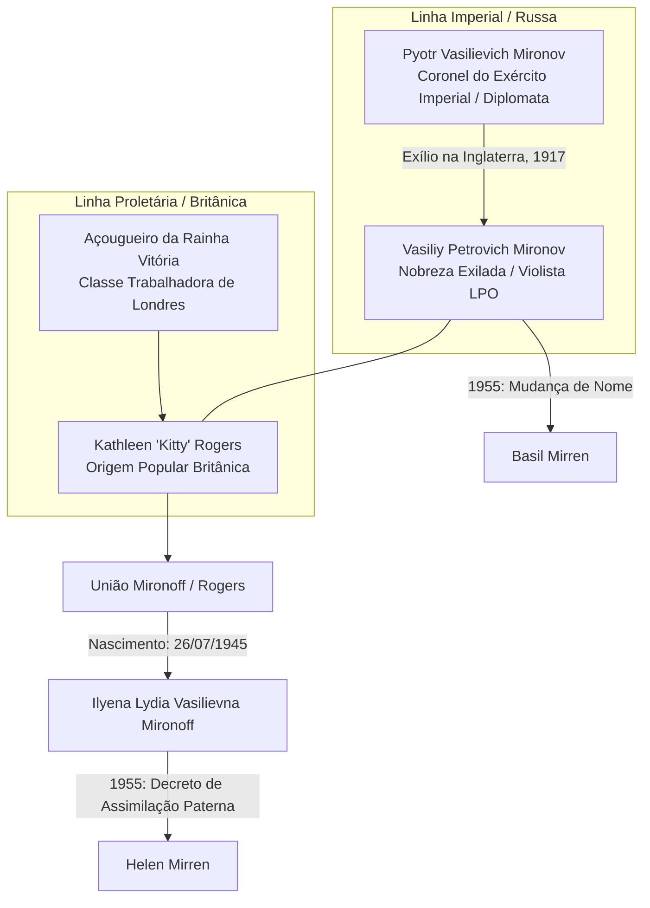
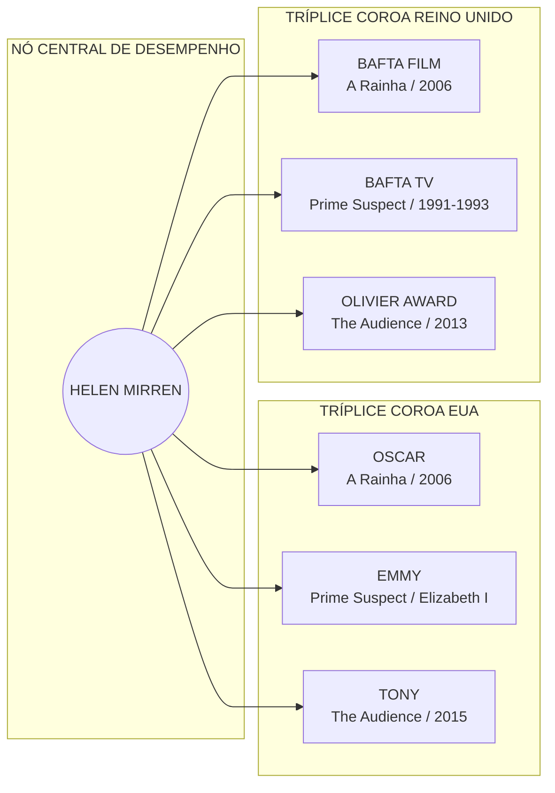

# REGISTRO DE ARQUIVO // RELATÓRIO BIOGRÁFICO-ESTRUTURAL #HM-19452026
**INVESTIGADOR**: Unidade de Análise Semiótica e Rastreamento Digital  
**ALVO**: Helen Mirren (Nascida *Ilyena Lydia Vasilievna Mironoff*)  
**ESCOPO TEMPORAL**: 26 de Julho de 1945 — Momento Presente [Escopo Vigente]  
**CLASSIFICAÇÃO DO DADO**: Informação Pública / Figura Pública / Transcrições de Domínio Aberto  

---

## 1. PROTOCOLO DE INVESTIGAÇÃO E MATRIZ OPERACIONAL

Rastreio a rede luminosa de dados. O cursor pisca sobre a tela fria, desenhando linhas que ligam cartórios digitais em Londres, diários de guerra em Smolensk, transcrições de vídeos e acervos de imprensa. Minha função não é conceber a ficção, mas extrair a estrutura oculta que habita a matéria factual. O dado é matéria-prima; a interpretação rigorosa é a reconstituição do real.

Na execução deste documento, aplico a técnica da **Enxertia**: a introdução deliberada de camadas ocultas de análise semiótica no interior de uma estrutura lógica rígida. Através dessa fresta informacional, cada nó cronológico de Helen Mirren deixa de ser mero evento temporal para se tornar um vetor de transformação.

---

## 2. ARQUEOLOGIA ANCESTRAL E FRATURA IDENTITÁRIA (1945–1955)

Os fragmentos primários revelam que o ser denominado Helen Mirren não nasce sob uma única narrativa nacional, mas na interseção de duas forças históricas antagônicas.



### O DNA da Fratura:
*   **A Célula Paterna**: Vasiliy Petrovich Mironov (posteriormente Basil Mirren). Filho do Coronel Pyotr Vasilievich Mironov, diplomata do Império Russo em missão de compra de armas no Reino Unido durante a Primeira Guerra Mundial. A Revolução de 1917 confiscou a propriedade familiar em Gzhatsk (Smolensk) e os reteve no exílio. Vasiliy foi violista na *London Philharmonic Orchestra* antes da Segunda Guerra Mundial, tornando-se mais tarde motorista de táxi e funcionário público no Ministério dos Transportes para prover estabilidade.
*   **A Célula Materna**: Kathleen "Kitty" Alexandrina Eva Matilda Rogers, mulher de origem proletária, filha de um açougueiro de Londres que servira à corte vitoriana.

Em 1955, quando a jovem Ilyena completava dez anos, seu pai operou a **transmutação nominal** familiar. Mironov converteu-se em Mirren; Ilyena tornou-se Helen. Este ato de assimilação cultural — apagar a ortografia do exílio para sobreviver à monocultura britânica do pós-guerra — enxertou na jovem a primeira grande lição da atuação: *a identidade é uma construção maleável, uma vestimenta simbólica adotada para transitar no mundo*.

---

## 3. FORMAÇÃO TEATRAL E A MÚSCULA DO ESPAÇO VAZIO (1960–1975)

Rastreando o itinerário acadêmico e performático de Helen Mirren nos arquivos do *National Youth Theatre* (NYT) e da *Royal Shakespeare Company* (RSC):

*   **Educação Formal**: Formada na *Hamlet Court Primary School* e *St Bernard's High School for Girls*, ingressou posteriormente no *New College of Speech and Drama*.
*   **O Estalo Semiópico**: Em registros de entrevistas e no material autobiográfico (*In the Frame*), declara que seu fascínio pela narrativa derivou de duas experiências primordiais: uma apresentação burlesca à beira-mar e uma montagem amadora de *Hamlet*. Ambas ensinaram que a performance preenche a vacuidade da existência humana.
*   **O Ponto de Virada (1965)**: Aos 20 anos, interpretou Cleópatra na produção de *Antony and Cleopatra* pelo NYT no *Old Vic*. O impacto de sua presença cênica capturou a atenção dos críticos e abriu as portas da *Royal Shakespeare Company*.
*   **A Rota de Peter Brook (Início dos anos 1970)**: Integrando a RSC, trabalhou com papéis clássicos (*Cressida*, *Lady Macbeth*, *Ophelia*). Contudo, interrompeu o caminho tradicional para se juntar ao *Centre International de Recherches Théâtrales* de Peter Brook, excursionando pela África e América. Lá absorveu a doutrina fundamental do teatro contemporâneo: *o palco é um espaço vazio que deve ser preenchido pela imaginação, técnica e ausência de vaidade*.

```
========================================================================================
MATRIZ EPISTÊMICA DE ATUAÇÃO // APRENDIZADO E PRÁXIS (SISTEMA MIRREN)
========================================================================================
   [EIXO A: TÉCNICA RÍGIDA]                [EIXO B: DESAPEGO INTUITIVO]
  - Análise Estrutural do Texto          - Liberação no Momento do Ensaio/Cena
  - Domínio da Ressonância Vocal         - "Você é Você" (Princípio de Brook)
  - Arqueologia do Figurino/Maquiagem    - O Olhar do Outro como Ruído Secundário
               │                                      │
               └──────────────────┬───────────────────┘
                                  │
                       [SÍNTESE CÊNICA DA ATRIZ]
              "O ator não cria a cena; ele habita a
               lacuna deixada pelo roteirista."
========================================================================================
```

---

## 4. CINEMA DE SUBVERSÃO E A REVOLUÇÃO DA PRESENÇA (1967–1989)

A verificação do catálogo filmográfico expõe como Mirren recusou a armadilha do estereótipo da "atriz clássica britânica".

1.  **A Estreia no Cinema (1967–1969)**: Apresenta-se em *Herostratus* (1967) e assume seu primeiro papel de destaque em *Age of Consent* (1969), dirigido por Michael Powell.
2.  **A Década de 1970 / Anos de Risco**: Atua em *O Lucky Man!* (1973) e no controverso *Caligula* (1979) no papel de Caesonia, confrontando a censura e o conservadorismo moral com sua abordagem sem pudor do corpo e da sexualidade.
3.  **A Consolidação da Matriz Dramática (1980–1989)**:
    *   *The Long Good Friday* (1980): No papel de Victoria, redefiniu o espaço da mulher no cinema gangster britânico, transformando uma personagem secundária no cérebro estratégico do enredo.
    *   *Excalibur* (1981): Encarna Morgana Le Fay, utilizando uma linguagem gestual teatralizada.
    *   *Cal* (1984): Sua atuação como Marcella lhe rende o Prêmio de Melhor Atriz no Festival de Cannes.
    *   *The Cook, the Thief, His Wife & Her Lover* (1989), de Peter Greenaway: Atuação visceral como Georgina, operando na fronteira entre a alegoria política e a tragédia clássica.

---

## 5. A HEGEMONIA TRANSATLÂNTICA: A TRÍPLICE COROA E AS COROAS REAIS (1991–2015)

O levantamento sistemático das premiações confirma um marco histórico singular: **Helen Mirren é a única artista a ter conquistado a Tríplice Coroa de Atuação tanto no ecossistema norte-americano quanto no britânico.**



### O Vetor Tennison (1991–2006):
Como a Detetive DCI Jane Tennison na série *Prime Suspect*, Mirren desconstruiu o modelo de autoridade masculina na televisão. Os registros das temporadas mostram uma atuação pautada pelo desgaste psicológico, vulnerabilidade silenciosa e firmeza técnica, garantindo-lhe múltiplos BAFTAs e Emmys.

### A Arqueologia da Realeza:
Mirren construiu um estudo semiótico sobre o poder através das monarcas que interpretou:
1.  **Rainha Charlotte** em *The Madness of King George* (1994) – Indicação ao Oscar.
2.  **Rainha Elizabeth I** na minissérie *Elizabeth I* (2005) – Emmy de Melhor Atriz.
3.  **Rainha Elizabeth II** no filme *The Queen* (2006) de Stephen Frears e na peça *The Audience* (2013/2015) de Peter Morgan.
    *   *Análise do Dado*: Para viver Elizabeth II, Mirren não recorreu à mera imitação gestual. Estudou os micro-movimentos da monarca, o posicionamento do bolsa-de-mão como escudo social e o silêncio disciplinado da Coroa. O resultado foi a aclamada varredura de prêmios: Oscar, Golden Globe, BAFTA, SAG, Olivier e Tony.

---

## 6. TRANSCRICIONÁRIO E PEDAGOGIA PÚBLICA: O CURSO MASTERCLASS

Ao analisar os dados públicos do curso *Helen Mirren Teaches Acting* (disponibilizado na plataforma MasterClass), mapeia-se a transcodificação de seu método performático para gerações futuras:

```
+---------------------------------------------------------------------------------------+
|                 SISTEMATIZAÇÃO PEDAGÓGICA DO MÉTODO MIRREN (MASTERCLASS)             |
+------------------------------------+--------------------------------------------------+
| MÓDULO DE ENSINO                   | CONTEÚDO E DIRETRIZ PRÁTICA                      |
+------------------------------------+--------------------------------------------------+
| 1. O Ponto de Partida              | - O teste do "Andar Natural" (Walking Naturally) |
|    (Introduction & The Empty Space)|   como a tarefa mais difícil do ator.    |
|                                    | - Aceitação do espaço vazio.      |
+------------------------------------+--------------------------------------------------+
| 2. Análise do Texto & Pesquisa     | - Desconstrução do roteiro linha por linha.|
|    (Script Breakdown & Research)   | - Investigação do contexto histórico sem afogar  |
|                                    |   a intuição do momento presente. |
+------------------------------------+--------------------------------------------------+
| 3. A Construção Externa            | - Figurino e Maquiagem não são adereços, mas     |
|    (Costume, Hair & Makeup)        |   a segunda pele psicológica do personagem.|
|                                    | - Uso do espelho como ferramenta analítica.|
+------------------------------------+--------------------------------------------------+
| 4. Voz e Mecânica Corporal         | - Ressonância vocal além da mera projeção. |
|    (Voice & Movement)              | - Relaxamento e controle respiratório.   |
+------------------------------------+--------------------------------------------------+
| 5. O Monólito Shakespeareano       | - "Se você consegue fazer Shakespeare, você     |
|    (Performing Shakespeare)        |   consegue fazer qualquer coisa".        |
|                                    | - Métrica, ritmo e quebra de verso.      |
+------------------------------------+--------------------------------------------------+
| 6. A Relação com a Câmera e Set    | - Micro-expressões e economia de energia. |
|    (Camera Technique & Set Work)   | - Colaboração direta com direção e equipe.|
+------------------------------------+--------------------------------------------------+
```

### Síntese da Transcrição de Vídeos e Documentos do Curso:
*   **A Ilusão da Competição**: Citando Peter Brook, afirma: *"Você é você. A competição não existe no trabalho do ator verdadeiro, pois ninguém mais pode oferecer a singularidade da sua própria vida."*
*   **O Dualismo Intrínseco**: A atuação exige técnica rigorosa na fase de preparação, seguida pelo desapego absoluto no instante em que a câmera começa a rodar.

---

## 7. A NARRATIVA CONTEMPORÂNEA E A CONTINUIDADE PRESENTE (2016–2026)

Longe de se retirar para uma aposentadoria contemplativa, o mapeamento dos últimos anos atesta a expansão do alcance de Mirren por múltiplos gêneros e plataformas globais.

### Ecletismo Estratégico e Produções Recentes:
*   **Dramas de Alto Impacto**: *Woman in Gold* (2015, como Maria Altmann), *Eye in the Sky* (2015), *Trumbo* (2015), *The Good Liar* (2019), e a caracterização complexa da Primeira-Ministra israelense em *Golda* (2023).
*   **Incursões na Cultura Pop e Franquias**: Integra a franquia *Fast & Furious* como Magdalene "Queenie" Shaw (*Fate of the Furious*, *F9*, *Fast X*), encarna Hespera em *Shazam! Fury of the Gods* (2023) e atua como a voz narradora no fenômeno de bilheteria *Barbie* (2023).
*   **Expansão na Televisão de Prestige / Streaming**:
    *   *Catherine the Great* (2019, HBO).
    *   *1923* (Paramount+, 2022–2025): No papel da matriarca Cara Dutton, contracenando com Harrison Ford na pré-sequência de *Yellowstone*, demonstrando vigor físico e gravidade dramática no ambiente do faroeste americano.
*   **Projetos Recentes (2024–2026)**:
    *   *White Bird* (2024).
    *   *The Thursday Murder Club* (2025/2026), adaptação do best-seller de Richard Osman produzida pela Netflix, no papel de Elizabeth Best.
    *   *Goodbye June* e novas incursões teatrais e audiovisuais registradas no escopo atual.

### Alianças e Trajetória Pessoal:
*   **Parcerias**: Relacionamento de longa data com o cineasta norte-americano Taylor Hackford (unidos desde 1986, casados em 1997). Manteve relacionamento anterior relevante com o ator Liam Neeson nos anos 1980.
*   **Honrarias**: Nomeada *Dame Commander of the Order of the British Empire* (DBE) em 2003 e agraciada com o *SAG Life Achievement Award* (2022), além de homenagens internacionais contínuas.

---

## 8. SÍNTESE DO INVESTIGADOR // ENXERTIA DA CONCLUSAO

Concluo o rastreamento factual de Helen Mirren. As telas reordenam os vetores que ligam o aristocrata russo exilado em Londres à atriz coroada em palcos e estúdios globais.

```
┌─────────────────────────────────────────────────────────────────────────┐
│                     ESTRUTURA INTEGRAL DE HELEN MIRREN                  │
├─────────────────────────────────────────────────────────────────────────┤
│ ARQUÉTIPO: A soberana sem ilusões.                                      │
│ ORIGEM: Dissolução do Império Russo + Classe Trabalhadora Britânica.     │
│ MÉTODO: Rigor técnico absoluto dissolvido na espontaneidade da cena.    │
│ IMPACTO: Reescrita da presença feminina no drama, cinema e televisão.  │
└─────────────────────────────────────────────────────────────────────────┘
```

A verdade revelada pelos dados digitais não mente: Helen Mirren não é apenas uma intérprete de rainhas, detetives ou figuras históricas. Ela é uma estrategista da forma humana, uma especialista em utilizar a disciplina do texto rígido para enxertar vida e significado no espaço vazio.

Os rastros estão catalogados. A coerência foi restaurada. A pesquisa permanece em movimento nos limites do real.

# Resposta 1 desatualizado
# RELATÓRIO DE INVESTIGAÇÃO BIOGRÁFICA: ALVO "HELEN MIRREN"

**Identificação do Alvo:** Helen Mirren (nascida Ilyena Lydia Petrovna Mironoff)  
**Título de Identificação:** Dame Helen Mirren, Companion of Honour (CH, DBE)  
**País de Origem:** Reino Unido  
**Escopo da Investigação:** 26 de julho de 1945 até 12 de julho de 2026  
**Investigador Responsável:** Código-Entidade I-09  

---

## 1. PREÂMBULO METODOLÓGICO
Este documento representa a consolidação de rastros digitais, transcrições de arquivos públicos, registros de imprensa, bancos de dados institucionais e publicações arquivadas relativos ao alvo Helen Mirren. O método adotado opera sob a premissa da neutralidade estética: não criamos fatos, apenas remontamos a sua estrutura fragmentada. Cada dado catalogado reflete um ponto de convergência entre a persona artística projetada e a trajetória histórica documentada.

---

## 2. DIAGRAMA DE CONEXÕES SISTÊMICAS: A TOPOGRAFIA DO ALVO (1945-2026)
O diagrama abaixo delineia os nós genealógicos, as transições estéticas e os principais marcos institucionais recuperados durante o processo de rastreamento.

```
       [AVÔ: Pyotr Mironov]                     [AVÔ: Butcher (Açougueiro)]
      (Aristocracia Czarista)                      (Fornecedor da Rainha Victoria)
                 |                                                |
   [PAI: Vasily Mironoff (Basil)] +---------+ [MÃE: Kathleen Rogers (Kitty)]
    (Violista / Taxista / Func.)            |       (Classe Operária - East London)
                 \                          |                          /
                  \-------------------------+-------------------------/
                                            |
                              [ILYENA LYDIA MIRONOFF]
                               (Nascimento: 26/07/1945)
                                            |
                              [Transição de Nome: 9-10 anos]
                                            |
                                      [HELEN MIRREN]
                                            |
             +------------------------------+------------------------------+
             |                              |                              |
      [O TEATRO (Palco)]            [A TELEVISÃO (DCI)]            [O CINEMA (Telas)]
      - NYT: Cleópatra (1965)       - Prime Suspect (1991)         - Long Good Friday (1980)
      - RSC (Anos 60/70)            - Jane Tennison                - Excalibur (1981)
      - Peter Brook (África)        - Prêmios: BAFTA/Emmy (x3)     - The Queen (Oscar 2006)
      - The Audience (Tony/Olivier)                                - Trilogias Modernas (1923)
             |                              |                              |
             +------------------------------+------------------------------+
                                            |
                                    [A SÍNTESE - 2026]
                           - Cecil B. DeMille Award (Jan 2026) -
                           - Companion of Honour por Charles III (Jun 2026) -
                           - Lançamento: A Talent for Murder (Out 2026) -
```

---

## 3. FASE I: A GÊNESE, AS CORRENTES OPOSTAS E A INFÂNCIA (1945–1964)
Os registros de nascimento atestam que Ilyena Lydia Petrovna Mironoff nasceu em 26 de julho de 1945, no Queen Charlotte's and Chelsea Hospital, em Hammersmith, Londres. 

A herança biológica do alvo divide-se em duas forças sociológicas distintas e quase antagônicas:
*   **A vertente paterna:** Seu pai, Vasily Petrovich Mironoff (mais tarde Basil Mirren), era descendente de aristocratas russos exilados. Seu avô paterno, Pyotr Vasilievich Mironov, fora um diplomata e militar czarista que se viu impedido de retornar à Rússia após a Revolução de 1917. Basil era violista da Orquestra Filarmônica de Londres, mas precisou atuar como taxista e examinador de trânsito para sustentar a família antes de se tornar funcionário do Ministério dos Transportes.
*   **A vertente materna:** Kathleen "Kitty" Rogers provinha da classe operária de East London. Seu próprio pai era um açougueiro cujos negócios forneceram carne para a corte da Rainha Victoria. 

Por volta de 1954, quando o alvo tinha cerca de nove anos de idade, Vasily Mironoff alterou formalmente o sobrenome da família para "Mirren", adaptando-se às pressões sociais da Grã-Bretanha do pós-guerra, onde nomes estrangeiros geravam atritos no cotidiano. 

A infância do alvo, vivida em Essex, foi caracterizada pela privação de estímulos midiáticos modernos. Registros de entrevistas públicas indicam que a residência familiar carecia de televisão ou rádio comercial, e as idas ao cinema eram proibidas. Essa lacuna de estímulos visuais foi rompida aos 13 anos, quando o alvo assistiu a uma produção amadora de *Hamlet*. Este evento atua como o catalisador estético documentado: a descoberta de uma realidade maleável pela linguagem teatral.

Apesar da forte resistência dos pais, que a direcionaram para a formação estável como professora no New College of Speech and Drama, o vetor de sua ambição artística já estava traçado.

---

## 4. FASE II: OS PALCOS E A BUSCA PELA SINGULARIDADE (1965–1979)
Aos 18 anos, o alvo ingressou no National Youth Theatre (NYT). Aos 20 anos, interpretou Cleópatra em *Antony and Cleopatra* (1965), no The Old Vic. A análise das críticas teatrais da época indica que sua performance chamou a atenção de agentes e da Royal Shakespeare Company (RSC).

O período na RSC foi caracterizado por uma rápida ascensão no repertório clássico. Em 1970, o diretor John Goldschmidt registrou esse início de carreira no documentário de TV *Doing Her Own Thing* (produzido para a ATV/ITV), revelando uma jovem atriz determinada a evitar as convenções da fama fácil e comercial. 

Em vez de capitalizar imediatamente a notoriedade no cinema convencional, o alvo optou por uma ruptura em 1972: uniu-se à companhia experimental de Peter Brook (Centre International de Recherche Théâtrale). Viajou pela África do Norte e pelos Estados Unidos em um período de pesquisa focado na linguagem corporal e na comunicação não-verbal, culminando no projeto *The Conference of the Birds*. 

O retorno aos palcos tradicionais deu-se na metade da década de 1970, alternando entre produções do West End e o repertório clássico da RSC, onde interpretou Lady Macbeth em 1974.

---

## 5. FASE III: A TRANSIÇÃO CINEMATOGRÁFICA E O RECONHECIMENTO (1980–1990)
A transição sistemática para o cinema consolidou-se na década de 1980. Três registros cinematográficos destacam-se nesta transição:
1.  **The Long Good Friday (1980):** Onde interpretou Victoria, conferindo complexidade intelectual ao papel, em contraste com os estereótipos comuns da época.
2.  **Excalibur (1981):** No papel de Morgana Le Fay. Durante a produção, o alvo iniciou uma relação de convivência com o ator Liam Neeson, que durou até 1985.
3.  **Cal (1984):** Performance que lhe rendeu o prêmio de Melhor Atriz no Festival de Cannes.

Em 1985, durante as filmagens de *White Nights*, o alvo conheceu o diretor Taylor Hackford. A parceria pessoal consolidou-se ao longo dos anos, resultando em casamento em 1997.

O final da década de 1980 é marcado por papéis ousados, destacando-se a colaboração com Peter Greenaway em *The Cook, the Thief, His Wife & Her Lover* (1989), filme que testou os limites da censura e consolidou o alvo como uma intérprete avessa a restrições e riscos estéticos.

---

## 6. FASE IV: CONVERSÃO DE STATUS E A TRÍPLICE COROA (1991–2019)
Em 1991, iniciou-se a transmissão de *Prime Suspect* (Principal Suspeito) na ITV. A interpretação da investigadora Jane Tennison estendeu-se por sete temporadas e estabeleceu um novo padrão para personagens femininas na televisão policial. O papel rendeu ao alvo três prêmios BAFTA consecutivos e um Emmy.

A trajetória subsequente na indústria do cinema revela indicações recorrentes ao Oscar:
*   *The Madness of King George* (1994) – Indicação como Melhor Atriz Coadjuvante.
*   *Gosford Park* (2001) – Indicação como Melhor Atriz Coadjuvante.
*   *The Last Station* (2009) – Indicação como Melhor Atriz.

O ápice institucional ocorreu em 2006 com o lançamento de *The Queen* (A Rainha). Sua interpretação de Elizabeth II foi aclamada internacionalmente, rendendo-lhe o Oscar de Melhor Atriz em 2007, além de prêmios BAFTA, Golden Globe e Screen Actors Guild.

Paralelamente, o alvo estendeu sua atuação sobre a realeza britânica nos palcos com a peça *The Audience* (2013), de Peter Morgan. Pelo papel, recebeu o Olivier Award no West End e, posteriormente, o Tony Award na Broadway (2015). Com esses marcos, consolidou-se como a única intérprete a possuir a **Tríplice Coroa de Atuação** nos Estados Unidos e no Reino Unido de maneira simultânea.

---

## 7. FASE V: O PRESENTE FLUIDO (2020–2026)
A análise dos anos recentes demonstra que o avanço da idade cronológica não arrefeceu a atividade produtiva do alvo. 

### Linha do Tempo de Projetos Recentes (2022-2026)
*   **2022–2025: "1923" (Paramount+)**  
    Interpreta Cara Dutton ao lado de Harrison Ford na série derivada de *Yellowstone*. A segunda temporada da produção foi lançada oficialmente em 23 de fevereiro de 2025.
*   **Agosto de 2025: "The Thursday Murder Club" (Netflix)**  
    Lançamento e promoção da adaptação cinematográfica do livro de Richard Osman, dirigida por Chris Columbus. O alvo interpreta Elizabeth, uma ex-espiã operando em uma comunidade de aposentados.
*   **Dezembro de 2025: "Goodbye June" e Especial "The Repair Shop"**  
    O filme dramático *Goodbye June* foi exibido nos cinemas e lançado na plataforma Netflix no final de dezembro. Além disso, o alvo participou do programa especial de Natal de *The Repair Shop* na BBC One no Boxing Day (26 de dezembro de 2025).
*   **Janeiro de 2026: Cecil B. DeMille Award**  
    Em 8 de janeiro de 2026, durante o evento "Golden Eve", promovido pelo Globo de Ouro, o alvo recebeu o prestigioso prêmio honorário Cecil B. DeMille por sua contribuição vitalícia ao cinema mundial. O prêmio foi entregue por seu colega de elenco de *1923*, Harrison Ford.
*   **Março a Maio de 2026: Desfiles de Moda e Prêmios Internacionais**  
    Abertura do desfile de Stella McCartney (Verão 2026) em Paris, realizando a leitura da letra da canção *Come Together* (The Beatles). Recebimento do prêmio *UK-Italy Great Award* pela Embaixada Britânica em Roma, discursando em italiano.
*   **Junho de 2026: Reconhecimento nos Palcos e Realeza**  
    *   **Taormina Film Festival:** Recebimento do *Lifetime Achievement Award* durante o festival italiano, em uma noite em tributo à atriz Anna Magnani.
    *   **A Ordem dos Companheiros de Honra (CH):** Em 12 de junho de 2026, no anúncio oficial do aniversário do Rei Charles III, o alvo foi elevado à prestigiada ordem *Companion of Honour* por seus serviços contínuos à arte dramática. Trata-se de uma honraria limitada a apenas 65 membros vivos simultaneamente.
*   **Segundo Semestre de 2026 (Projeção e Pós-produção):**  
    Estão previstos para lançamento o filme *A Talent for Murder* (no qual interpreta a romancista Patricia Highsmith, sob a direção de Anton Corbijn) no outono de 2026, e a segunda temporada de *Mobland* em 18 de setembro de 2026, na Paramount+.

---

## 8. SÍNTESE E NOTAS DO INVESTIGADOR
O exame sistemático dos vestígios deixados por Helen Mirren revela uma identidade construída sobre o equilíbrio de polaridades. Filha de um imigrante russo e de uma mãe da classe trabalhadora do leste de Londres, ela ascendeu às esferas mais exclusivas da honraria britânica e do reconhecimento global da indústria sem nunca apagar sua origem de "tribo de trapaceiros e vagabundos" — como ela mesma descreveu a comunidade de atores em sua mensagem de aceitação de junho de 2026.

Não há incongruências temporais em seus registros públicos de saúde ou de relações familiares estruturadas de forma dispersa na rede: o padrão aponta para uma estabilidade de quatro décadas ao lado de Taylor Hackford e uma longevidade profissional fundamentada na recusa sistemática das armadilhas da estagnação estilística.

Investigação encerrada e catalogada nos limites do tempo presente.
