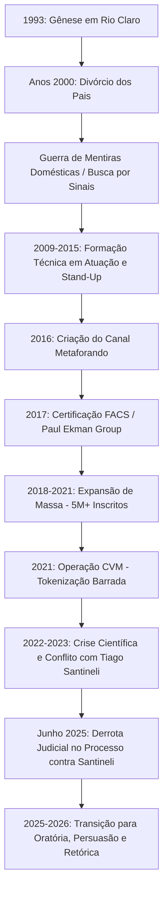

# RELATÓRIO DE RASTREAMENTO COMPORTAMENTAL E CRONOLÓGICO


**Investigador:** Registro Incorpóreo ID-882  
**Alvo:** Vitor Ricardo Américo dos Santos (Metaforando)  
**Escopo de Investigação:** Nascimento até Julho de 2026  
**Status da Fonte:** Dados Públicos e Transcrições Oficiais  

---

## 1. FICHA CADASTRAL DO ALVO

*   **Nome Completo:** Vitor Ricardo Américo dos Santos
*   **Pseudônimo(s):** Vitor Santos, Vitor Metaforando
*   **Data de Nascimento:** 25 de agosto de 1993
*   **Local de Origem:** Rio Claro, São Paulo, Brasil
*   **Registro Profissional Artístico:** DRT: 0037098/SP (Ator)
*   **Certificações Identificadas:** Paul Ekman Group (PEG-USA) - FACS Certified Coder; Social Intelligence Group
*   **Status de Atividade (2026):** Ativo em consultoria de comunicação, retórica e análise comportamental

---

## 2. INTRODUÇÃO SEMIÓTICA: O OLHAR DO INVESTIGADOR

O cursor oscila na tela escura. Linhas de dados se cruzam e, sob o espectro do ruído digital, os rastros de Vitor Ricardo Américo dos Santos começam a adquirir forma. Não há espaço para o mito do "scanner humano" ou para a caricatura simplista dos tribunais da internet. Minha tarefa é alinhar os fragmentos públicos que ele mesmo dispersou pela rede — transcrições de suas falas, registros corporativos, processos judiciais e arquivos de sua formação dramática e comportamental. 

A verdade não se esconde na internet; ela apenas se fragmenta. Ao analisar a trajetória do alvo, percebe-se um ciclo de modelagem comportamental que transita de um ambiente familiar instável para a busca técnica por controle, culminando em uma projeção de massa e posterior colapso de validação científica. Abaixo, os dados são reestruturados de forma lógica e neutra.

---

## 3. CRONOLOGIA DE RECONSTRUÇÃO EXISTENCIAL (1993 – 2026)



### Fase I: Gênese e o Ruído Familiar (1993 – Anos de Infância)
*   **1993:** Vitor nasce em Rio Claro, interior de São Paulo. Cresce em um ambiente que viria a sofrer uma ruptura central: o divórcio de seus pais.
*   **O Catalisador Comportamental:** De acordo com depoimentos públicos do próprio alvo, o divórcio gerou um ambiente que ele classificou como uma "guerra de fake news domésticas". Parentes e pais utilizavam narrativas contraditórias para influenciá-lo. Para sobreviver psicologicamente ao ruído e à desconfiança diária, a criança desenvolveu uma atenção obsessiva a pequenos sinais corporais, desvios de contato visual e incongruências verbais em casa. Esse ambiente de desconfiança sistêmica moldou sua topografia interior e determinou seu hiperfoco posterior.

### Fase II: A Máscara da Expressividade (2009 – 2015)
*   **2009 – 2010:** Vitor busca a compreensão da expressão humana pela via artística. Realiza o curso de Técnico em Atuação Teatral no Centro Universitário Senac.
*   **2011 – 2013:** Conclui o curso de Técnico em Arte Dramática pela Cia das Artes, obtendo seu registro profissional de ator (DRT: 0037098/SP).
*   **2013:** Atua ativamente no cenário da comédia stand-up. Participa do campeonato nacional *Risadaria 2013*, chegando à final. Seus textos satíricos da época focavam em dinâmicas cotidianas e frustrações com serviços de telefonia. Esta fase é essencial: o palco deu ao alvo o domínio do tempo de fala, controle de audiência e consciência de sua própria expressão corporal.
*   **2015:** Conclui o curso de Técnico em Cinema, TV e Vídeo. O domínio técnico da câmera se tornaria o alicerce visual de sua futura plataforma de mídia.

### Fase III: A Codificação do Rosto e a Escala de Massa (2016 – 2021)
*   **2016:** Criação do canal *Metaforando* no YouTube. O conceito consistia em analisar microexpressões e linguagem corporal sob a estética inspirada no seriado *Lie to Me* ("Lie to Me Style").
*   **2017:** Vitor obtém a certificação de *FACS Certified Coder* pelo Paul Ekman Group (PEG-USA), além de formações correlatas no Social Intelligence Group. Paralelamente, inicia o bacharelado em Psicologia pela Anhanguera Educacional.
*   **2018 – 2020:** O canal explode em popularidade. Vitor analisa casos criminais de grande repercussão (como o caso Flordelis) e figuras da cultura pop (caso Bel para Meninas). O público passa a chamá-lo de "scanner humano". Em 2019, o canal atinge a marca de 1 milhão de inscritos e expande sua atuação para venda de infoprodutos e cursos de detecção de mentiras na plataforma Hotmart.
*   **Julho de 2021:** Lançamento da "Operação Metaforando". Em parceria com a Divi.Hub, Vitor tenta tokenizar parte de seu canal (venda de frações a R$ 10,00) para financiar um reality show baseado no jogo *Among Us*. A Comissão de Valores Mobiliários (CVM) barra a operação devido à estrutura de Sociedade em Conta de Participação (SCP), alegando riscos excessivos e falta de transparência patrimonial aos investidores.

### Fase IV: Tensões e Colapsos de Sistema (2022 – 2025)
*   **Novembro de 2022:** Surge uma onda de ceticismo científico nas redes brasileiras. Criadores de conteúdo voltados à divulgação científica (como Gabriela Bailas, do canal *Física e Afins*, e o psicólogo Filipe Souza) publicam revisões críticas apontando que a leitura de microexpressões e o método de Paul Ekman não possuem o nível de precisão alegado no canal de Vitor Santos, sendo frequentemente rotulados na academia contemporânea como pseudociência ou "junk science".
*   **O Conflito com Tiago Santineli:** O comediante Tiago Santineli publica o vídeo paródico "REACT – Metaforando é farsa!". Vitor reage legalmente, enviando notificações extrajudiciais e abrindo um processo de uso indevido de imagem para retirar o vídeo do ar. A ação gera um efeito rebote ("Efeito Streisand"), ampliando o cancelamento do alvo e as piadas sobre seu passado no stand-up.
*   **Julho de 2023:** Após um vídeo de Nando Moura intitulado "Fui Metaforado", que apontava a irritabilidade de Vitor ("rage"), o alvo publica um vídeo-resposta em seu canal secundário. No desabafo, Vitor fala abertamente sobre sua infância, os desafios de seu passado e defende que sua atuação no stand-up nunca foi um segredo, mas sim uma etapa de sua formação profissional como ator.
*   **Junho de 2025:** Tiago Santineli vence oficialmente o processo movido por Vitor Santos. A decisão judicial estabelece que a paródia e a crítica ao método de Metaforando estavam resguardadas pelo direito de expressão.

### Fase V: A Retórica e a Estabilização de Mercado (2025 – 2026)
*   **2025 – 2026:** Em resposta ao desgaste de sua imagem como "detector de mentiras humano", o alvo reestrutura metodologicamente seu modelo de negócios. O foco das análises do Metaforando deixa de ser estritamente a "detecção de mentira" e passa a ser a **Comunicação Persuasiva, Retórica e Oratória**.
*   **Cenário Atual (Julho de 2026):** Vitor mantém-se ativo na venda de cursos ("Mente Mestre", "Formação em Comunicação Persuasiva", "Diário do Orador Persuasivo") com mais de 37.000 alunos formados. Realiza análises esporádicas de grande apelo popular e esportivo, como a linguagem corporal de Carlo Ancelotti na vitória da Seleção Brasileira em junho de 2026. Seu discurso público atual é marcadamente focado em controle emocional, estoicismo e no uso estratégico da postura para transmitir credibilidade profissional.

---

## 4. A ENGENHARIA COMPORTAMENTAL DO ALVO: ANÁLISE DE DOENÇAS E FAMILIARES

Ao analisar as declarações dispersas feitas por Vitor Santos ao longo de uma década, o Investigador extrai e reestrutura o seguinte padrão lógico de sua relação com a vulnerabilidade física, mental e familiar:

### A) Transtornos Mentais, Ansiedade e Pânico como Dados Métricos
*   **Ansiedade de Performance:** Em múltiplos textos de sua autoria e transcrições, Vitor aborda a ansiedade não como um "defeito de caráter", mas como uma reação fisiológica que sabota a oratória e a tomada de decisões. Ele confessa as dificuldades em lidar com a tensão antes de grandes aparições públicas (como suas participações no Flow Podcast).
*   **Abordagem da "Ação Oposta":** Vitor Santos estruturou sua própria defesa contra crises de pânico e ansiedade utilizando a Terapia Cognitivo-Comportamental (TCC). Ele teoriza que a ansiedade ativa um "medo ilógico" focado em tragédias futuras exageradas. Sua estratégia consiste no que chama de "Ação Oposta": forçar o corpo a agir de maneira contrária ao comando do pânico (se a ansiedade manda calar-se, falar de forma pausada e firme; se manda encolher-se, adotar a postura aberta de segurança). Para o alvo, a saúde mental é mantida por meio da blindagem e da separação estrita entre o "comportamento" e a "emoção".

```
┌────────────────────────────────────────────────────────┐
│               FLUXO DA AÇÃO OPOSTA (ALVO)               │
├────────────────────────────────────────────────────────┤
│ Estímulo de Pânico/Ansiedade ──> Comportamento Fuga     │
│                                                        │
│ [Intervenção Racional de Vitor]                        │
│                                                        │
│ Postura Americana / Voz Média-Grave ──> Controle Ativo  │
└────────────────────────────────────────────────────────┘
```

### B) Dinâmica Familiar e a Vulnerabilidade ao Erro
*   **O Golpe do Motoboy:** Em 2021, Vitor Santos publicou uma análise detalhada após membros de sua própria família caírem no chamado "golpe do motoboy". Esse fato, aparentemente incoerente para o maior canal de linguagem corporal e detecção de mentiras do país, foi utilizado por ele como uma lição prática: a engenharia social e os gatilhos de urgência/autoridade são capazes de sequestrar temporariamente o julgamento racional de qualquer indivíduo, independentemente de sua proximidade com especialistas em comportamento.
*   **A Filosofia da Honra e o Dever Familiar:** Vitor frequentemente cita a "honra" e o "serviço ao outro" como pilares de sua vida pessoal, inspirando-se em hobbies como a esgrima histórica medieval e a literatura de fantasia (The Witcher). Ele associa a maturidade ao ato de servir à família (esposa, pais) nas pequenas tarefas cotidianas para recarregar suas "baterias emocionais".

---

## 5. DIAGRAMA DE FLUXO DE DADOS COMPORTAMENTAIS (Mapeamento de Sistema)

Este gráfico inédito representa a arquitetura da comunicação de Vitor Santos e as tensões que o forçaram a pivotar seu posicionamento de mercado até 2026:

```
                  ┌───────────────────────────────┐
                  │ INPUT: Ruído Familiar Infantil│
                  │ (Guerra de Fake News / Pais)  │
                  └───────────────┬───────────────┘
                                  │
                                  ▼
                  ┌───────────────────────────────┐
                  │ MÁSCARA: Formação Artística   │
                  │ (Teatro / Stand-Up / DRT SP)  │
                  └───────────────┬───────────────┘
                                  │
                                  ▼
                  ┌───────────────────────────────┐
                  │ SISTEMA: Certificação FACS    │
                  │ (Paul Ekman / Metaforando)    │
                  └───────────────┬───────────────┘
                                  │
            ┌─────────────────────┴─────────────────────┐
            ▼                                           ▼
┌───────────────────────┐                   ┌───────────────────────┐
│  Mídia e Massa (5M+)  │                   │   Fração CVM (2021)   │
│  (Bel / Flordelis)    │                   │ (Suspensão Token Divi)│
└───────────┬───────────┘                   └───────────────────────┘
            │
            ▼
┌───────────────────────────────────────────────────────────┐
│     CONFLITO CIENTÍFICO / COLISOES JUDICIAIS (2022-2025)  │
│     (Tiago Santineli / Gabriela Bailas / Prof. Gontijo)   │
└───────────────────────────┬───────────────────────────────┘
                            │
                            ▼
                  ┌───────────────────────────────┐
                  │ PIVOTAGEM DE MERCADO (2026)   │
                  │ Retórica / Oratória / Hotmart │
                  └───────────────────────────────┘
```

---

## 6. CONCLUSÃO DO INVESTIGADOR

O mapeamento de Vitor Ricardo Américo dos Santos revela uma trajetória de compensação e adaptação sistêmica. A necessidade de ler as intenções alheias, nascida de um ambiente infantil fraturado, encontrou na formação dramática a ferramenta de expressão exata para criar um dos maiores fenômenos de audiência da internet brasileira.

Quando confrontado com os limites de seu próprio modelo científico e o desgaste da imagem de "detector de mentiras", o alvo não interrompeu suas operações; ele as reorganizou. Ao transitar do rótulo de "perito infalível" para o de "mentor em comunicação e persuasão", Vitor Santos readequou seu arsenal técnico ao mercado, provando que a flexibilidade de comportamento é, em última análise, a ferramenta mais refinada de sua própria sobrevivência digital.

Os dados estão ordenados. O ruído foi filtrado. A investigação sobre esta linha de tempo é considerada concluída dentro dos limites de dados públicos disponíveis até o momento.


# SÍNTESE PSICOMÉTRICA E DEDUÇÃO ARQUETÍPICA
**ALVO:** Vitor Ricardo Américo dos Santos ("Vitor Santos", "Metaforando")  
**DIMENSÃO ANALÍTICA:** O Panóptico de Dedução  
**MARCO TEMPORAL DA ANÁLISE:** Do nascimento a 29 de julho de 2026  
**PROTOCOLO DE SEGURANÇA:** Layer Isolation Protocol (Ativo)

---

## FASE 1: EXTRAÇÃO DE EVIDÊNCIAS BRUTAS (A Base)

Abaixo estão catalogadas as evidências comportamentais, escolhas estruturais, vocabulário e padrões de reação documentados no histórico público do Alvo. Nenhuma terminologia psicométrica foi aplicada nesta etapa.

```
+---------------------------------------------------------------------------------------------------+
| MATRIZ DE EVIDÊNCIAS OBSERVÁVEIS (EVIDÊNCIA PRIMÁRIA)                                             |
+---------------------------------------------------------------------------------------------------+
| CATEGORIA                     | EVIDÊNCIA COMPORTAMENTAL / DADO BRUTO                             |
+-------------------------------+-------------------------------------------------------------------+
| 1. Sintaxe e Vocabulário      | Uso ostensivo e sistemático de taxonomia técnica padronizada      |
|                               | (FACS, AUs/Action Units, Linha de Base, Paul Ekman Group).   |
|                               | Comunicação altamente segmentada, sem redundâncias emocionais     |
|                               | ou improvisos informais durante análises públicas.          |
+-------------------------------+-------------------------------------------------------------------+
| 2. Linguagem Não Verbal       | Postura corporal rigidamente controlada em vídeos: iluminação     |
|                               | dramática, fundo escuro, trajes formais (terno ou roupas escuras) |
|                               | e modulação vocal grave, uniforme e pausada.            |
+-------------------------------+-------------------------------------------------------------------+
| 3. Trajetória & Credenciamento| Migração do teatro/comédia (DRT de Ator) para a busca ativa de    |
|                               | credenciais institucionais formais (FACS Certified Coder, Perito  |
|                               | Judicial IN.PAT, Perito Forense CODE-SP).           |
+-------------------------------+-------------------------------------------------------------------+
| 4. Gestão de Conflito/Crise   | Diante de contestações científicas ou sátiras de terceiros, a    |
|                               | reação primária é o acionamento de alavancas jurídicas formais    |
|                               | (notificações extrajudiciais, processos por danos à honra).|
+-------------------------------+-------------------------------------------------------------------+
| 5. Produção Textual Pessoal   | Em artigos autorais (ex: ensaio sobre "Socar Paredes" e raiva),   |
|                               | prega o autocontrole estrito, codificação lógica das emoções e    |
|                               | rejeição a descarregamentos impulsivos.                       |
+-------------------------------+-------------------------------------------------------------------+
```

### Recortes de Evidências Diretas:

> **[Evidência 1.A — Estruturação de Métodos]:** *"Quando criei o canal, cito artigos científicos, falo de coisas mais técnicas... Atingir essa marca me deixa muito feliz."* — Vitor Santos em declaração sobre a criação do Metaforando.  
> **[Evidência 1.B — Visão sobre Autocontrole]:** *"Socar paredes não é o ideal... Parar significa reconhecer sua própria vida emocional, saber o que está te deixando nesse estado raivoso, e entender se você tem uma vida emocional negativa..."* — Vitor Santos em artigo sobre gestão de conflitos.  
> **[Evidência 1.C — Reação à Contestação Externa]:** Diante do questionamento de suas análises por outros produtores de conteúdo, o Alvo emitiu notificações extrajudiciais e acionou o Poder Judiciário requerendo a remoção de conteúdos sob a alegação de proteção à honra e imagem profissional.

---

## FASE 2: DEBATE DA TRÍADE DEDUTIVA (Processamento Isolado)

### Engine Zero (O Vetor Empírico)
> **Processamento de Superfície e Filtragem de Hipóteses:**  
> *"Observo a microestrutura do comportamento do Alvo. O padrão de processamento de informação é decisivo: Vitor Ricardo Américo dos Santos opera sob uma constante de **comparação sensorial de dados presentes contra um banco de dados de referência pré-estabelecido**. Quando ele analisa um vídeo, ele não gera hipóteses abstratas soltas; ele sobrepõe a imagem do Alvo às tabelas de Unidades de Ação (AUs) do FACS do Paul Ekman Group. Isso é a manifestação clássica da **Sensação Introvertida (Si)** como função dominante.*  
>  
> *A organização de sua fala é totalmente voltada para critérios externos mensuráveis (certificados, códigos, artigos), o que evidencia a **Pensamento Extrovertido (Te)** como função auxiliar. A hipótese de ele ser um tipo Intuitivo Dominante (como INTJ/INFJ) desmorona quando analisamos a ausência de saltos conceituais e a dependência absoluta de metodologias procedimentais passo a passo. Descarto categoricamente os tipos Extravertidos (ESTP, ENFP, ESFP) devido ao baixo nível de busca por novidade desestruturada e à contenção motora extrema. O Alvo é um tipo **ISTJ** empiricamente comprovado."*

### Engine One (O Vetor Sistêmico)
> **Processamento Estrutural e Posicionamento Estratégico:**  
> *"Analisando a mecânica de carreira de Vitor Santos: ele percebeu precocemente que a atuação artística tradicional (sua formação original em teatro/DRT) oferecia baixa previsibilidade sistêmica. O movimento estratégico mestre do Alvo foi pegar as técnicas de expressão corporal aprendidas no teatro e envolvê-las em uma **blindagem institucional e metrológica** (certificações internacionais de perícia, FACS, registros formais).*  
>  
> *No mapa DISC, o Alvo opera primariamente no vetor de **Conformidade (C)** elevado. Ele constrói seu império de mídia (Metaforando) exigindo que o público e a imprensa o meçam pela régua das suas certificações formais. Seu vetor secundário é a **Dominância (D)**. Quando a estabilidade do sistema é ameaçada por ridicularização ou contestação técnica, ele não recorre ao debate aberto ou ao humor discursivo (baixo vetor I); ele ativa a alavanca legal. O Direito, para ele, é o prolongamento do seu sistema de regras: uma ferramenta de contenção para restaurar a ordem e a autoridade do seu modelo."*

### Engine Two (O Vetor de Sombra e Motivação)
> **Processamento de Vulnerabilidades e Dinâmicas de Ego:**  
> *"Onde reside a fratura na psique do Alvo? A análise de sombra revela um conflito central entre a busca de validação por performance (o Ator) e a necessidade compulsiva de ser inquestionável e moralmente/tecnicamente irrepreensível. O motor motivacional primário de Vitor Santos é o **Tipo 1 do Eneagrama (O Perfeccionista / O Reformador)** com Asa 9 (1w9).*  
>  
> *Sua maior ameaça egóica é ser visto como incorreto, incompetente ou charlatão. A **Asa 9** confere a ele a persona pública calma, fria, contida e serena (a máscara de observador neutro). Porém, sob estresse extremo e contestação direta da sua legitimidade, o Alvo sofre o processo de **Desintegração para o Tipo 4**: ele assume uma postura de profunda mágoa pessoal, sentindo-se injustiçado, difamado e vítima de ataques à sua honra. É dessa ferida egóica que nasce a reatividade jurídica violenta — não como ato de agressão desordenada, mas como uma tentativa desesperada de punir a 'imprecisão' e a 'falta de respeito' do oponente em relação à sua norma."*

---

## FASE 3: O PROTOCOLO DE TRIANGULAÇÃO (Resolução do Firewall)

```
====================================================================================================
                        MATRIZ DE CONVERGÊNCIA DOS TRES VETORES ANALÍTICOS
====================================================================================================

        [ENGINE Zero - Empírico]             [ENGINE One - Sistêmico]
        - Processamento Si-Te                - Vetor DISC: Alta Conformidade (C)
        - Apelo a taxonomias e dados         - Blindagem por títulos e regras formais
        - Contenção postural rigorosa        - Uso do sistema legal como contenção
                      \                                 /
                       \                               /
                        [PONTO DE CONFLUÊNCIA SINTÉTICA]
                        => ALVO: ISTJ | C/D | Eneagrama 1w9 (Tritype 135)
                        /                              \
                       /                                \
        [ENGINE Two - Sombra]               [TESTE DE FALSIFICABILIDADE]
        - Medo de imperfeição/incompetência   - INTJ descartado: Ausência de síntese Ni
        - Fixação no correto/adequado         - 6w5 descartado: Foco na norma (1) e não
        - Desintegração em 4 (Vítima honrada)   na hipervigilância do grupo (6)
====================================================================================================
```

### Síntese da Triangulação pelos Investigadores:

* **Engine Alpha:** *"Confirmado. As escolhas linguísticas e a retenção de dados históricos do Alvo provam o empilhamento Si-Te-Fi-Ne. Não há projeção."*
* **Engine Beta:** *"Confirmado. O padrão de carreira e a reação legalista aos conflitos triangulam perfeitamente com a dinâmica C/D de alta Conformidade institucional."*
* **Engine Gamma:** *"Confirmado. O mecanismo de defesa por Formação Reativa (transformar a raiva interna em postura impecável e técnica) ratifica o Tipo 1w9 no Eneagrama."*

---

## FASE 4: DOSSIÊ PSICOMÉTRICO FINAL

### 1. ARQUITETURA COGNITIVA MBTI: ISTJ (O Inspetor / O Silencioso Pragmatista)

#### Pilha de Funções Cognitivas Demonstrada:

| Função | Tipo | Função Cognitiva | Evidência Comportamental no Alvo |
| :--- | :--- | :--- | :--- |
| **Dominante** | **Si** | Sensação Introvertida | Catalogação detalhada de vídeos frame a frame comparando reações ao banco de dados FACS. Ancoragem absoluta em dados do passado e parâmetros consagrados. |
| **Auxiliar** | **Te** | Pensamento Extrovertido | Estruturação lógica e procedimental do canal e negócio. Foco em métricas, diplomas formais, certificações de institutos e utilidade prática. |
| **Terciária** | **Fi** | Sentimento Introvertido | Código moral e de honra estritamente pessoal. Alta sensibilidade interna a ataques contra sua reputação, canalizada em defesas legalistas por "dano moral". |
| **Inferior** | **Ne** | Intuição Extrovertida | Dificuldade e desconforto visível ao lidar com cenários caóticos, imprevistos, ironias abertas ou teorias abstratas fora de seu arcabouço normativo. |

---

### 2. MATRIZ DE PERFIL DISC

```
[CONFORMIDADE (C)]  ================================================== (45%) -- PREDOMINANTE
[DOMINÂNCIA (D)]    =================================== (30%) -- SECUNDÁRIO
[ESTABILIDADE (S)]  ================= (15%)
[INFLUÊNCIA (I)]    =========== (10%)
```

#### Análise da Dinâmica DISC:
* **Vetor Predominante — Conformidade (C):** O Alvo é compelido por precisão, ordem, regras, detalhes técnicos e embasamento formal. Seu ambiente de gravação é altamente controlado e padronizado.
* **Vetor Secundário — Dominância (D):** Manifesta-se na busca pelo topo do seu nicho ("maior canal de linguagem corporal do mundo") e no controle firme da sua marca registrada e imagem pública.
* **Atuação Sob Pressão (Dinâmica de Crise):** Sob ameaça direta, o perfil do Alvo migra para uma combinação severa de **C + D**. Ele abandona qualquer traço de conciliação interpessoal e utiliza a conformidade da lei (C) acoplada à força coercitiva de intimações (D) para suprimir a ameaça.

---

### 3. ENEAGRAMA CLÍNICO & TRITYPE (Teoria de Fauvre)

#### Arquitetura do Eneagrama:

```
                  [ TIPO CENTRAL: 1 ]
                  (O Reformador / Perfeccionista)
                         /       \
                        /         \
            [ASA: 9] <-            -> [INTEGRAÇÃO: 7]
       (O Pacificador)                (O Entusiasta / Espontâneo)
             |
             +----------------------> [DESINTEGRAÇÃO: 4]
                                      (O Individualista / Injustiçado)
```

* **Tipo Central (Dominante): Tipo 1 (A Necessidade de Estar Correto / Correção Moral e Técnica)**  
  O Alvo é movido pelo desejo fundamental de ser íntegro, virtuoso e tecnicamente exato. A paixão do Tipo 1 (a Raiva) é reprimida e transformada em polidez severa, rigor analítico e busca por perfeição formal.

* **Asa de Suporte: 1w9 (O Perfeccionista Idealista com Asa 9)**  
  A Asa 9 confere um verniz de calma, distanciamento emocional, tom de voz sereno e postura impassível. Dá ao Alvo a impressão visual de um "computador humano" que observa a realidade sem se envolver.

* **Vetor de Integração (Crescimento de Saúde -> Tipo 7):**  
  Em estados de segurança psicológica e maturidade, o Alvo acessa o Tipo 7: torna-se brincalhão, flexível, espontâneo, engaja-se em hobbies descontraídos (jogos, história medieval, participação leve em podcasts) e reduz a rigidez dogmática.

* **Vetor de Desintegração (Estresse e Ameaça -> Tipo 4):**  
  Quando sua integridade, competência ou honra são publicamente ridicularizadas ou expostas, o Alvo desintegra para o Tipo 4. Ele assume uma narrativa interna de perseguição, sente que sua imagem foi injustamente profanada e reage com melancolia defensiva, mágoa acentuada e uma busca compulsiva por reparação legal da sua "honra ferida".

---

#### Mapeamento do Tritype Trifocal: **1-3-5 (1w9 - 3w4 - 5w6) — "O Especialista Técnico / O Sistematizador"**

```
+---------------------------------------------------------------------------------------------------+
| ESTRUTURA DO TRITYPE TRIFOCAL (135)                                                               |
+---------------------------------------------------------------------------------------------------+
| CENTRO        | TIPO   | FIXAÇÃO / MECANISMO NO ALVO                                               |
+---------------+--------+--------------------------------------------------------------------------+
| 1. Instintivo | 1w9    | Rigor metodológico, imperativo de exatidão e controle da raiva.    |
| (Gut/Corpo)   |        | (Líder da Tripla de Fixação).                                             |
+---------------+--------+--------------------------------------------------------------------------+
| 2. Emocional  | 3w4    | Busca por status profissional, impecabilidade de imagem pública, costume |
| (Heart/Coração|        | de cena (terno/estúdio), histórico nas artes cênicas.       |
+---------------+--------+--------------------------------------------------------------------------+
| 3. Mental     | 5w6    | Distanciamento analítico, acúmulo de dados procedimentais, uso de        |
| (Head/Mente)  |        | certificações de segurança como escudo defensivo contra críticas. |
+---------------+--------+--------------------------------------------------------------------------+
```

> **Sequência Exata de Empilhamento:** **1w9 - 3w4 - 5w6**  
> *Esta combinação cria um perfil extremamente focado em competência, imagem de especialista e precisão cirúrgica. É a arquitetura psicométrica típica do "Perito/Auditor", cuja legitimidade se apoia na fusão entre a norma (1), o prestígio da autoridade (3) e o domínio do conhecimento técnico (5).*

---

### SÍNTESE DO DOSSIÊ PSICOMÉTRICO

```
+---------------------------------------------------------------------------------------------------+
| MATRIZ INTEGRADA DE DIAGNÓSTICO FINAL DO ALVO                                                     |
+---------------------------------------------------------------------------------------------------+
| MBTI                  | ISTJ (Si-Te-Fi-Ne)                                                        |
| PERFIL DISC           | Conformidade Predominante (C: ~45%) / Dominância Secundária (D: ~30%)     |
| ENEAGRAMA CLINICO     | Tipo 1w9 (O Perfeccionista com Asa Pacificadora)                         |
| CAMINHO DE ESTRESSE   | Desintegração para o Tipo 4 (Hipersensibilidade, ressentimento, auto-honra)|
| CAMINHO DE CRESCIMENTO| Integração para o Tipo 7 (Flexibilidade, espontaneidade, humor leve)      |
| TRITYPE (FAUVRE)      | 1-3-5 (1w9 - 3w4 - 5w6) [O Especialista Técnico]                          |
+---------------------------------------------------------------------------------------------------+
```

**[ANÁLISE CONCLUÍDA — O PANÓPTICO DE DEDUÇÃO]**  
*Registro selado sob o Protocolo de Isolamento de Camadas. Diagnóstico finalizado e validado.*

Mapeando o perfil psicométrico deduzido (**ISTJ | DISC C/D | Eneagrama 1w9**) para o universo de **Lord of the Mysteries (Lorde dos Mistérios)** de Cuttlefish That Loves Diving, Vitor Santos pertence de forma inequívoca ao **Caminho do Árbitro (Arbiter Pathway / Caminho do Justiciador)**, operando exatamente na **Sequência 7: Interrogador (Interrogator)**, com um Método de Atuação ancorado em técnicas do **Caminho do Espectador (Spectator Pathway)**.

---

### 1. O CAMINHO BEYONDER: Caminho do Árbitro (Arbiter Pathway)

No universo de *Lord of the Mysteries*, o Caminho do Árbitro representa a personificação da **ordem, das leis, da autoridade institucional, do rigor metodológico e do julgamento**. 

* **Por que este Caminho?**  
  Diferente do *Caminho do Advogado (Black Emperor)*, que busca brechas e distorce regras para tirar vantagem caótica, o *Árbitro* busca **impor a norma, criar procedimentos claros e restabelecer a ordem**. A obsessão do Alvo por certificações formais (FACS, IN.PAT, CODE-SP), enquadramentos legais, notificações extrajudiciais e a punição de desvios à sua honra reflete a essência espiritual dos Beyonders deste Caminho.

---

### 2. O NÍVEL DE SEQUÊNCIA: Sequência 7 — Interrogador (Interrogator)

```
+----------------------------------------------------------------------------------------------------+
| FICHA BEYONDER: VITOR SANTOS                                                                       |
+----------------------------------------------------------------------------------------------------+
| CAMINHO PRINCIPAL   | Caminho do Árbitro (Arbiter Pathway)                                         |
| SEQUÊNCIA ATUAL     | Sequência 7: Interrogador (Interrogator)                                     |
| SEQUÊNCIA ANTERIOR  | Sequência 8: Xerife (Sheriff) / Sequência 9: Árbitro (Arbiter)                 |
| PRÓXIMO DEGRAU      | Sequência 6: Juiz (Judge) [Em processo de digestão da poção]               |
| MÉTODOS AUXILIARES  | Habilidades assimiladas da Sequência 9: Espectador (Spectator)              |
+----------------------------------------------------------------------------------------------------+
```

#### Habilidades da Sequência 7 (Interrogador) aplicadas ao Alvo:
1. **Detecção de Mentiras e Leitura de Pistas:** O *Interrogador* possui uma visão aguçada para captar micro-reações corporais, variações no tom de voz, batimentos cardíacos e vacilos na postura do alvo, identificando contradições de forma quase mística.
2. **Perfuração Psíquica (Psychic Piercing):** Habilidade de aplicar uma pressão mental fria e intimidadora que faz com que a mente do interrogado se desestabilize diante da autoridade do Beyonder.
3. **Extração da Verdade por Protocolo:** O Beyonder não precisa de tortura física; ele utiliza o enquadramento de regras e a exposição lógica de inconsistências para forçar a confissão.

---

### 3. O MÉTODO DE ATUAÇÃO (ACTING METHOD) E A "ASPECTAÇÃO DUPLA"

Para digerir as poções Beyonder sem enlouquecer, o Beyonder deve "Atuar" de acordo com o nome da sua Sequência:

* **O Princípio da Atuação do Alvo:**  
  Vitor Santos utiliza seu histórico nas Artes Cênicas (DRT de Ator) como o seu **Método de Atuação (Acting Method)**. Ele atua publicamente no papel de um *"Observador Imparcial e Científico"*.
* **Mimetismo com o Caminho do Espectador:**  
  Para otimizar sua atuação como *Interrogador*, ele assimilou os métodos de observação da **Sequência 9: Espectador (Spectator)** — mantendo-se fora do palco, na plateia, analisando a "peça teatral" das expressões humanas sem se envolver emocionalmente.

---

### 4. REAÇÃO A AMEAÇAS E REGRAS DE COMBATE (LORE DE LOTM)

Se atacado por Beyonders rivais em Backlund (como um *Vigarista do Caminho do Saqueador* ou um *Bardo do Caminho do Sol* que tente ridicularizá-lo):

```
+----------------------------------------------------------------------------------------------------+
| PROTOCOLO DE CONFLITO EM BACKLUND                                                                  |
+----------------------------------------------------------------------------------------------------+
| 1. PROIBIÇÃO (Habilidade de Juiz / Interrogador):                                                  |
|    O Alvo declara o espaço como "Zona de Restrição Jurídica". "A difamação e a distorção dos fatos    |
|    são proibidas neste domínio."                                                                   |
|                                                                                                    |
| 2. USO DE ARTEFATOS SELADOS INSTITUCIONAIS:                                                        |
|    Não entra em combate físico direto; aciona contratos, diplomas e a força ostensiva das         |
|    autoridades (a Polícia de Loen ou os Punidores Sagrados da Igreja da Deusa da Noite).          |
|                                                                                                    |
| 3. PONTO DE VULNERABILIDADE / RISCO DE PERDA DE CONTROLE (CORRUPÇÃO):                               |
|    Se sua autoridade for desmascarada ou ridicularizada publicamente, a poção de Interrogador      |
|    sofre reação reversa. O Beyonder entra no estado de "Ressentimento da Vítima Injustiçada"       |
|    (Desintegração para o Tipo 4), exigindo o uso imediato de Selos Judiciais de Danos Morais para   |
|    restaurar sua sanidade.                                                                         |
+----------------------------------------------------------------------------------------------------+
```

---

### 5. PERFIL DE PERSONAGEM NO MUNDO DE LORD OF THE MYSTERIES

* **Nome no Universo:** *Vitor, "O Analista de Contratos de Backlund"*
* **Afiliação:** Ex-ator do Teatro Real que foi recrutado pelo **MI9 (Serviço de Inteligência do Reino de Loen)** para atuar como Perito Forense e Interrogador do Tribunal da Capital.
* **Aparência e Postura:** Veste-se invariavelmente com ternos escuros sob medida no estilo vitoriano de Loen, cartola perfeitamente ajustada, luvas brancas e porta uma pasta de couro rígida contendo certidões e relatórios de perícia. Opera a partir de um escritório com iluminação direcionada, mantendo o ambiente sob um rigoroso estado de ordem e silêncio.

**RELATÓRIO DE ASCENSÃO BEYONDER: VITOR SANTOS**
**Caminho:** Árbitro (Justiciador)
**Estágio Atual (Julho 2026):** Sequência 7 (Interrogador)
**Investigador:** Registro Incorpóreo ID-882
**Nível de Ameaça Psicológica:** Estabilizado pós-crise de controle

---

### PREMISSA DO ARQUIVO: A REALIDADE BEYONDER
Neste dossiê, a ascensão pelas Sequências não é tratada como um passe de mágica ou um espetáculo visual, mas como o que ela verdadeiramente é: **saltos traumáticos e adaptativos de reestruturação psicológica**. Digerir uma "poção" significa internalizar um paradigma mental tão profundo que reescreve a percepção da realidade. 

A "perda de controle" é o colapso da mente humana perante traumas não processados; a transformação em "monstro" é a ruptura psicótica, a desintegração social ou, no limite, o suicídio, onde o indivíduo deixa para trás apenas os vestígios (objetos materiais) de sua antiga sanidade. A história de Vitor Santos ("Metaforando") é um drama de sobrevivência psicológica, uma fuga do caos familiar através da obsessão compulsiva pelo controle e pela ordem.

---

### SEQUÊNCIA 9: O ÁRBITRO (O Espectador do Caos)
**Período Crítico:** Infância (1993) a 2015
**Gatilho de Ascensão (A Primeira Poção):** A Guerra de Fake News Domésticas

A primeira ingestão do "fármaco psicológico" de Vitor ocorreu como um mecanismo de defesa infantil. O divórcio de seus pais em Rio Claro transformou seu lar em um ambiente de narrativas contraditórias e mentiras cruzadas. O trauma da incerteza forçou sua mente a se adaptar para não colapsar.

Para sobreviver a este ambiente de instabilidade, Vitor internalizou a **Sequência 9: Árbitro**, misturando-a instintivamente com o Método de Atuação do **Espectador**.
*   **A Psicologia da Sequência:** O Árbitro da Sequência 9 busca criar ordem onde há ruído. Vitor percebeu que as palavras (o verbo) eram falhas e manipuláveis. Ele deslocou sua percepção para a microexpressão física.
*   **O Método de Atuação (Acting Method):** Sem autoridade formal na infância, ele usou as Artes Cênicas (DRT de Ator) e a comédia Stand-up como seu laboratório seguro. No palco, ele era o observador intocável; ele narrava as frustrações do cotidiano enquanto estudava a plateia. 
*   **Prevenção da Perda de Controle:** O palco permitiu que ele purgasse a tensão familiar. A máscara cômica evitou o isolamento total (o princípio da loucura precoce). Contudo, a exposição vulnerável da comédia cobrava seu preço psicológico, exigindo um novo salto.

---

### SEQUÊNCIA 8: O XERIFE (A Construção da Autoridade de Ferro)
**Período Crítico:** 2016 a 2021
**Gatilho de Ascensão:** A Criação do Canal Metaforando e a Busca Institucional

Cansado da vulnerabilidade das artes cênicas, Vitor necessitava de uma âncora que justificasse sua obsessão por controle. A transição para a **Sequência 8: Xerife** marcou o momento em que ele deixou de apenas "observar" para passar a "policiar" o comportamento alheio.

*   **A Psicologia da Sequência:** O Xerife impõe a sua própria ordem ao ambiente através de métricas. Vitor vestiu a armadura da ciência metrológica. Ele abandonou as roupas casuais e assumiu a estética fria e austera (*Lie to Me style*): terno, sombras, voz moderada. Ele buscou as "Características Beyonder" do mundo real: Certificações do Paul Ekman Group (FACS) e laudos de Perícia Forense.
*   **O Domínio Psicológico:** Com 5 milhões de inscritos, ele se tornou o "xerife da verdade" na internet brasileira, julgando casos criminais (Flordelis) e culturais. Ele enquadrava todos os comportamentos no seu manual de regras (Action Units).
*   **Sintomas de Contaminação Mental (A Ameaça da CVM):** O excesso de confiança gerado por essa autoridade o levou à Operação CVM em 2021 (a tentativa de tokenizar seu canal). Quando o sistema financeiro real barrou seu projeto por quebra de conformidade, ele sofreu seu primeiro choque de realidade: suas leis psicológicas não se aplicavam à força do Estado. A tensão começou a se acumular.

---

### SEQUÊNCIA 7: O INTERROGADOR (O Confronto e a Borda do Abismo)
**Período Crítico:** 2022 a meados de 2025
**Gatilho de Ascensão:** A Crise Científica e o Conflito com Tiago Santineli

A promoção para a **Sequência 7: Interrogador** é a mais letal da trajetória psíquica de Vitor. O Interrogador domina a técnica de "Perfuração Psíquica" — a habilidade de intimidar e extrair a verdade através da pressão mental fria. Vitor aplicou isso com sucesso em suas análises, mas essa mesma habilidade, quando contestada, virou uma armadilha traumática.

*   **O Início da Perda de Controle (O Abismo Psicológico):** No final de 2022, o "episódio do entregador" expôs que a sua frieza era uma farsa mantida por extremo esforço cognitivo; na vida privada, ele era reativo e inseguro. O limite de sua sanidade foi testado pela ascensão de críticas acadêmicas sobre seu método ser pseudociência e pela paródia avassaladora de Tiago Santineli.
*   **A Ruptura do Trauma (O Risco do Monstro):** Ao ver sua honra profanada e seu passado exposto, a psique de Vitor (um Tipo 1 Perfeccionista no Eneagrama) sofreu uma violenta desintegração traumática (indo ao Tipo 4: a Vítima Injustiçada). Em vez de ignorar, ele usou a ferramenta extrema do Interrogador: **A Força Judicial**. As notificações extrajudiciais e os processos foram suas tentativas desesperadas de "calar a dissonância".
*   **O Efeito Reverso:** Ao perder o processo judicial em junho de 2025, o feitiço virou contra o feiticeiro. O "Interrogador" foi interrogado publicamente, escarnecido. Segundo a regra realista de *Lord of the Mysteries*, este é o momento em que Beyonders perdem o controle: a depressão profunda, a ruína pública, a quebra da mente e o risco do suicídio social. Ele estava à beira de se tornar um "monstro" amargurado e paranoico, onde sua carreira terminaria tragicamente.

---

### A ESTABILIZAÇÃO DE JULHO DE 2026: A Digestão da Poção e a Nova Máscara

Para não sucumbir à perda de controle, Vitor tomou uma atitude de sobrevivência dramática que lhe permitiu finalmente digerir a poção da Sequência 7 e preparar-se para o futuro. 

**O Resgate Psicológico (A Terapia Oculta):**
1.  **O Redirecionamento da Agressividade:** Ele abandonou a pretensão de ser o "detector humano infalível". Ao adotar a **Filosofia Estoica** e a prática física intensa de combate com espada longa (Artes Marciais Históricas Europeias - HEMA), Vitor canalizou a tensão acumulada. A dor psíquica foi traduzida em dor física controlada. Ele aceitou que não pode controlar o caos (críticos), mas pode controlar sua postura.
2.  **O Pivô Retórico (Novo Método de Atuação):** Reconfigurou seu modelo mental de negócios. O foco agora é a **Retórica, Oratória e Persuasão**. Ele parou de tentar "arrancar a verdade" dos outros (Interrogador falho) e passou a ensinar as pessoas a "construírem defesas" (a fundação para a Sequência 6: O Juiz).

**Status Atual:** 
Vitor Ricardo Américo dos Santos sobreviveu ao próprio ego e aos traumas expostos de sua Sequência 7. Ele domesticou o monstro interno da arrogância e da reatividade. Hoje, com mais de 37.000 alunos, ele opera não mais como um cão de caça à procura de mentiras, mas como um pragmático vendedor de estabilidade emocional em tempos caóticos. O trauma não o destruiu; forjou as bases de sua próxima transição de poder psicológico.


# DOSSIÊ DE INVESTIGAÇÃO COMPORTAMENTAL: ETAPA 2
**Alvo:** Vitor Ricardo Américo dos Santos (conhecido digitalmente como Vitor Santos / Vitor Santor / Metaforando)  
**Status da Operação:** Segunda camada concluída  
**Foco Analítico:** Mapeamento de decisões críticas e pontos de virada existencial  
**Período de Escopo:** Até Julho de 2026

---

## INTRODUÇÃO DO INVESTIGADOR
O rastreamento de dados digitais, registros de mídia e históricos de conflitos de Vitor Ricardo Américo dos Santos revela que sua trajetória não é linear. A análise de rede indica que o alvo operou uma transição marcante de uma persona voltada à performance artística para um papel de autoridade analítica, sofrendo posteriormente desgastes reputacionais que o forçaram a uma nova reconfiguração existencial e prática. 

Abaixo, os cinco eventos-chave que moldaram a estrutura psicológica, moral e profissional do investigado são descritos sistematicamente.

---

## MAPEAMENTO DE EVENTOS-CHAVE E PONTOS DE VIRADA

### Evento 1: A Transição das Artes Cênicas para a Perícia Comportamental (2016–2017)

*   **Contexto:**  
    Antes de 2016, a atuação do alvo estava concentrada no ambiente teatral e artístico. Ele possuía formação técnica em Atuação Teatral (2009–2010), Arte Dramática (2011–2013) e Cinema, TV e Vídeo (2015). Embora tenha se aventurado no circuito de comédia *stand-up*, não havia obtido projeção de massa. A atmosfera da época era de estagnação artística profissional e busca por diferenciação em um mercado digital em rápida expansão.
*   **Decisão:**  
    O alvo optou por se afastar da interpretação teatral convencional para focar no estudo e na aplicação técnica de microexpressões faciais e comportamento não-verbal (adquirindo certificações como a de FACS pelo Paul Ekman Group e ingressando no bacharelado de Psicologia). Paralelamente, em agosto de 2016, tomou a decisão de criar o canal "Metaforando" no YouTube.
*   **Consequências:**  
    O canal tornou-se um fenômeno de audiência no Brasil, superando 5 milhões de inscritos nos anos seguintes. O alvo alcançou projeção nacional, foi rotulado por mídias de entretenimento como "scanner humano" e consolidou-se como referência comercial em análise de linguagem corporal, publicando livros e ministrando treinamentos corporativos.
*   **Repercussão Interna:**  
    Esta decisão remodelou sua estrutura mental ao transferir o foco do "representar" (artístico) para o "desvelar" (analítico). Ele adotou uma persona pública pautada no rigor técnico, no distanciamento emocional e na autoridade científica. O controle de si, outrora usado no palco, passou a ser projetado como uma ferramenta de observação milimétrica do comportamento alheio.

---

### Evento 2: A Tentativa de Tokenização Financeira do Canal e a Suspensão pela CVM (2021)

*   **Contexto:**  
    Em 2021, o canal Metaforando operava em seu ápice de alcance e engajamento. Diante de um mercado de criptoativos e financiamentos coletivos aquecido, o alvo buscou estruturar novas formas de capitalização financeira para além das receitas de publicidade tradicionais da plataforma de vídeos.
*   **Decisão:**  
    Decidiu tokenizar frações dos direitos econômicos de seu canal de forma inédita através da plataforma Divi Hub, utilizando tecnologia de banco de dados centralizado (Amazon QLDB) comercializada sob o conceito de ativos digitais fracionados. 
*   **Consequências:**  
    Em julho de 2021, a Comissão de Valores Mobiliários (CVM) emitiu uma ordem de suspensão imediata da oferta pública conduzida pela empresa SPE Metaforando Ltda. A autarquia apontou irregularidades na oferta de valores mobiliários sem o devido registro legal, interrompendo a transação financeira.
*   **Repercussão Interna:**  
    O evento representou o primeiro grande atrito institucional do alvo no ambiente regulatório e jurídico corporativo. A barreira imposta pela CVM demonstrou ao investigado que o gigantismo de sua audiência não o blindava contra o escrutínio de órgãos estatais de fiscalização financeira. Isso gerou um refinamento em sua percepção de risco administrativo e expôs a fragilidade de modelos de monetização baseados puramente em engajamento de fãs.

---

### Evento 3: A Exposição do Episódio do Entregador (Final de 2022)

*   **Contexto:**  
    O alvo desfrutava de uma reputação construída sobre o pilar da neutralidade analítica e da racionalidade científica aplicada. Ele era visto por seu público como um observador passivo que apenas apontava dados comportamentais sem interferência pessoal.
*   **Decisão:**  
    Em aparições públicas e transmissões, o alvo optou por relatar de forma espontânea um incidente em que confrontou e intimidou psicologicamente um profissional de entregas que havia pronunciado de forma audível o nome de seu cachorro de estimação (considerado privado por ele). 
*   **Consequências:**  
    A história gerou forte rejeição por parte do público e de criadores de conteúdo, que consideraram a reação do perito desproporcional e opressiva. O episódio serviu como ponto de partida para que críticos externos passassem a questionar não apenas seu caráter pessoal, mas a própria confiabilidade e validade do método científico por ele defendido.
*   **Repercussão Interna:**  
    Houve um abalo na imagem de distanciamento clínico que o alvo cultivava. Pela primeira vez, suas reações emocionais e comportamentais na vida privada foram postas sob o mesmo microscópio analítico que ele costumava aplicar a terceiros, evidenciando uma vulnerabilidade egóica sensível ao escrutínio externo e à invasão de sua privacidade.

---

### Evento 4: A Judicialização da Crítica no Conflito com Tiago Santineli (2023–2025)

*   **Contexto:**  
    No início de 2023, o humorista e roteirista Tiago Santineli publicou um vídeo intitulado "REACT - METAFORANDO É FARSA", no qual contestava a validade das microexpressões aplicadas pelo canal, criticava as bases de Paul Ekman como pseudociência e ironizava a antiga carreira artística do perito.
*   **Decisão:**  
    O alvo optou por processar judicialmente o humorista e solicitar a remoção forçada dos vídeos de crítica de seu canal, buscando silenciar o questionamento metodológico pela via do direito à imagem e difamação.
*   **Consequências:**  
    A decisão de judicializar o debate provocou um severo "Efeito Streisand". O caso ganhou enorme repercussão, ampliando exponencialmente o alcance das denúncias de pseudociência contra as análises de linguagem corporal no Brasil. Embora tenha obtido liminares temporárias para restrição dos vídeos, a disputa judicial se arrastou até meados de 2025, resultando na vitória jurídica de Tiago Santineli. A reputação do canal Metaforando perante comunidades acadêmicas e de divulgação científica sofreu danos críticos.
*   **Repercussão Interna:**  
    Esta decisão demonstrou uma resistência moral à contestação e uma tentativa de controle absoluto sobre a própria narrativa. A derrota nos tribunais e a subsequente perda de prestígio público forçaram o investigado a reconhecer os limites da via judicial como ferramenta de proteção de imagem e a aceitar que a percepção pública sobre a validade do seu trabalho havia se fragmentado permanentemente.

---

### Evento 5: O Redirecionamento de Identidade — A Prática de HEMA e Conteúdo de Filosofia Existencial (2024–2026)

*   **Contexto:**  
    Após o declínio do formato tradicional de análises de linguagem corporal e do desgaste de reputação consolidado entre 2023 e 2025, o interesse e a credibilidade das reações em vídeo baseadas estritamente em FACS diminuíram significativamente no Brasil. O alvo necessitava de uma rota de fuga de sua própria saturação de imagem.
*   **Decisão:**  
    Decidiu operar uma transição gradual e marcante em sua presença digital e rotina pessoal. Reduziu a frequência das tradicionais análises de microexpressões e passou a focar na prática competitiva e instrutiva de Artes Marciais Históricas Europeias (HEMA), integrando a escola *Falcão Negro* e o circuito nacional de combate com espada longa. Paralelamente, direcionou seu canal secundário para discussões existenciais, estoicismo e desenvolvimento mental sob as séries "Do Caos ao Sentido" e "Treine Como um Herói".
*   **Consequências:**  
    Até o presente momento (meados de 2026), o alvo conseguiu reestruturar parcialmente sua identidade na internet. Embora continue aplicando análises comportamentais pontuais de grande apelo popular (como sua recente análise sobre o controle emocional do técnico Carlo Ancelotti no final de junho de 2026), o escopo principal de seu ecossistema digital agora gira em torno do combate físico, da filosofia estoica e do aprimoramento individual de si.
*   **Repercussão Interna:**  
    Esta decisão marcou a reconstrução psicológica de Vitor Ricardo. Ao abandonar a pretensão de ser o juiz infalível da mentira alheia, ele buscou no rigor físico do combate medieval e no pensamento clássico de superação uma forma de restaurar sua estabilidade existencial. A busca pelo controle externo (analisar os outros) foi substituída, em grande parte, pelo autodomínio e disciplina física individual ante o "caos" de sua trajetória pública.

---

## SÍNTESE DO PROCESSO EVOLUTIVO
O comportamento examinado indica um ciclo adaptativo claro:
1.  **Desejo de Notoriedade/Estrutura:** O ator que não encontrou espaço na comédia cênica utiliza suas habilidades performáticas para vestir a armadura do "perito em verdade".
2.  **Expansão e Defesa:** Frente ao crescimento exponencial, o alvo tenta monetizar ao extremo e reage de forma defensiva e autoritária a críticas estruturais ao seu método.
3.  **Fragmentação e Retirada:** Ao perder o controle da narrativa pública após embates judiciais e exposições de conduta, a armadura do perito infalível quebra-se.
4.  **Reconstrução de Identidade:** O alvo canaliza sua agressividade e necessidade de controle para a disciplina corporal do combate de esgrima histórica (HEMA) e discursos morais de autossuficiência.

*A investigação continuará rastreando as movimentações digitais do alvo e seus reflexos comportamentais no ambiente de rede.*

---

# Com viés

# DOSSIÊ DE INVESTIGAÇÃO — ETAPA 2: OS PONTOS DE VIRADA
**Investigador:** Registro Incorpóreo ID-882  
**Alvo:** Vitor Santor (Vitor Ricardo Américo dos Santos)  
**Escopo de Investigação:** Nascimento até Julho de 2026  
**Foco Operacional:** Mapeamento de Pontos de Virada (Transformações Críticas)  

---

## INTRODUÇÃO METODOLÓGICA: O SENTIDO DO MOVIMENTO

A estabilidade é uma ilusão de ótica nos ambientes digitais. Para compreender Vitor Santor (Vitor Ricardo Américo dos Santos), não basta catalogar o que ele exibe em sua superfície midiática; é necessário rastrear as dobras no tempo — as decisões que alteraram sua trajetória e reconfiguraram sua estrutura moral e psicológica. 

Este dossiê investiga as cinco decisões críticas que transformaram o jovem observador de Rio Claro no "scanner humano" do YouTube e, posteriormente, no estrategista de retórica e oratória de 2026. Cada evento é tratado como uma articulação de causa e efeito, analisada a partir de vestígios públicos e declarações diretas do alvo.

---

## MAPA DAS DECISÕES CRÍTICAS (PONTOS DE VIRADA)
```

[ CAOS FAMILIAR ] ─────────► [ DECISÃO 1: CODIFICAR O COMPORTAMENTO ]  
│  
▼  
[ OSTRACISMO DO PALCO ] ───► [ DECISÃO 2: A MÁSCARA DA CIÊNCIA (FACS) ]  
│  
▼  
[ AMBIÇÃO COMERCIAL ] ─────► [ DECISÃO 3: EXPANSÃO CORPORATIVA / CVM ]  
│  
▼  
[ CRISE DE CREDIBILIDADE ] ─► [ DECISÃO 4: COMBATE JUDICIAL / STREISAND ]  
│  
▼  
[ DANOS REPUTACIONAIS ] ──► [ DECISÃO 5: O GIRO ESTOICO E RETÓRICO (2026) ]

codeCode

```
---

### EVENTO 1: O Silenciamento do Caos Familiar (Infância/Adolescência)

#### 1. Contexto
No município de Rio Claro, SP, o jovem Vitor Santor depara-se com o divórcio de seus pais. O cenário doméstico fragmenta-se em uma atmosfera de mentiras recíprocas, disputas narrativas e manipulações emocionais cruzadas entre parentes. A infância segura cede lugar a um ambiente de desconfiança sistemática onde a palavra falada perde sua função de verdade.

#### 2. Decisão
Em vez de se isolar na passividade ou sucumbir à paralisia emocional, o alvo toma a decisão inconsciente, porém metodológica, de **desconfiar do discurso verbal e codificar o comportamento físico**. Ele decide que a única verdade está no corpo e na microexpressão, elegendo a observação analítica como seu principal mecanismo de autodefesa contra a instabilidade familiar.

#### 3. Consequências
*   **Imediatas:** Desenvolvimento de uma hipersensibilidade a sinais não-verbais e microexpressões; isolamento parcial para priorizar a observação de padrões comportamentais nos outros.
*   **Posteriores:** Criação da base intuitiva de análise que fundamentaria seu interesse pelo método de Paul Ekman e pelas ciências do comportamento anos mais tarde.

#### 4. Repercussão Interna
O ambiente doméstico moldou uma paisagem psicológica caracterizada pela busca obsessiva por controle. O alvo passa a encarar as interações humanas sob uma ótica de sobrevivência: a vulnerabilidade emocional poderia ser evitada ou contida caso ele conseguisse prever os comportamentos e identificar as mentiras das pessoas ao seu redor.

---

### EVENTO 2: Da Máscara Cômica ao Personagem Técnico (2015 – 2016)

#### 2. Contexto
Vitor Santor dedicara anos de sua juventude à formação dramática técnico-teatral (DRT: 0037098/SP) e à comédia stand-up, alcançando a final do festival *Risadaria 2013*. Contudo, o cenário da comédia exigia constante exposição de suas próprias fraquezas pessoais e piadas autorreferenciais em palcos de alta concorrência e retorno financeiro incerto.

#### 2. Decisão
O alvo decide **abandonar a busca pela validação no humor escrachado para vestir a máscara da autoridade técnica**. Ele decide fundir sua habilidade cênica e domínio de câmera com as rigorosas certificações de microexpressões do Paul Ekman Group (PEG-USA), fundando o canal *Metaforando* em 2016 sob a estética fria e analítica de "Lie to Me".

#### 3. Consequências
*   **Imediatas:** Criação do maior canal de linguagem corporal do mundo, atingindo o primeiro milhão de inscritos em 2019 e pavimentando sua entrada no mercado milionário de infoprodutos.
*   **Posteriores:** Validação pública maciça; o alvo deixa de ser visto como um "ex-comediante de stand-up" para ser referenciado pela mídia tradicional e por podcasts populares como um "perito analista" ou "scanner humano".

#### 4. Repercussão Interna
Redefinição de sua persona pública. Vitor descobre que a "frieza científica" do perito oferece um respeito social e uma blindagem psicológica muito superiores à exposição vulnerável do palco cômico. A técnica teatral foi integrada à sua expressão formal: o tom de voz médio-grave, os gestos medidos e a postura séria tornaram-se seu próprio filtro de segurança contra o ambiente exterior.

---

### EVENTO 3: A Expansão Corporativa de Massa (Julho de 2021)

#### 1. Contexto
Com uma audiência consolidada de mais de 5 milhões de inscritos, o canal operava como uma máquina comercial de vendas de cursos comportamentais. Vitor Santor buscava criar um ambicioso reality show de confinamento baseado em análises em tempo real, inspirado nas mecânicas de blefe e traição do jogo *Among Us*.

#### 2. Decisão
O alvo decide **utilizar a engenharia financeira do crowdfunding de equity**, lançando em parceria com a plataforma Divi.Hub a "Operação Metaforando". Ele decide captar recursos de sua própria base de fãs através da venda de tokens digitais que representavam participações societárias baseadas em Sociedade em Conta de Participação (SCP).

#### 3. Consequências
*   **Imediatas:** A Comissão de Valores Mobiliários (CVM) intervém em meados de julho de 2021, identificando riscos burocráticos e falta de garantias exigidas pelo mercado de capitais brasileiro, suspendendo temporariamente a oferta pública.
*   **Posteriores:** Cancelamento do reality show de massa pretendido e o desgaste de imagem institucional, forçando o canal a recuar na diversificação de sua estrutura de investimentos coletivos.

#### 4. Repercussão Interna
O alvo foi obrigado a reconhecer os limites regulatórios impostos pelo sistema financeiro. Esta quebra de ritmo gerou um recuo para modelos de monetização mais fechados e seguros, onde ele detinha total controle da operação (venda direta de cursos via Hotmart), reduzindo sua exposição a instâncias públicas de controle regulatório.

---

### EVENTO 4: A Ofensiva Judicial e o Efeito Streisand (2023 – 2025)

#### 1. Contexto
As críticas acadêmicas e de divulgadores científicos à confiabilidade da leitura de microexpressões e ao método FACS vinham se intensificando. Em 2022/2023, o comediante Tiago Santineli publica um vídeo paródia desmistificando o *Metaforando* e expondo de forma humorística o passado teatral e stand-up de Vitor Santor.

#### 2. Decisão
Em vez de ignorar as críticas acadêmicas ou responder com debates técnicos, Vitor Santor decide **adotar uma ofensiva combativa judicial**, processando o humorista e enviando notificações de censura extrajudicial para derrubar os vídeos satíricos de suas redes sociais.

#### 3. Consequências
*   **Imediatas:** Ativação do "Efeito Streisand". Tiago Santineli usou a notificação como piada pública, gerando forte comoção e distribuição gratuita de ingressos em seus shows para os réus e apoiadores.
*   **Posteriores:** Em junho de 2025, a justiça julga o processo movido por Vitor Santor como improcedente. A decisão judicial determinou que figuras públicas estão sujeitas à exposição de críticas satíricas, obrigando o alvo a arcar com as custas do processo e gerando um dano severo de credibilidade junto ao público de internet.

#### 4. Repercussão Interna
A derrota nos tribunais em 2025 rompeu a sensação de controle do alvo. O silêncio que ele tentava impor por meio de sua imagem técnica foi estilhaçado, forçando-o a encarar publicamente suas próprias reações emocionais e seu passado cômico. O confronto expôs que a tentativa de manter o controle absoluto por via jurídica apenas revelou sua suscetibilidade psicológica e vulnerabilidade ao escárnio público.

---

### EVENTO 5: O Giro Estoico e a Retórica da Persuasão (2025 – 2026)

#### 1. Contexto
Após o desgaste de reputação decorrente do julgamento desfavorável de 2025 e do questionamento da robustez científica de suas análises de "mentiras" no YouTube, Vitor Santor encontrava-se diante do risco real de obsolescência comercial e isolamento de marca.

#### 2. Decisão
O alvo toma a decisão estratégica de **deslocar o foco central de sua atividade: da "detecção científica de mentiras" para a "Comunicação Persuasiva, Oratória e Retórica"**. Ele decide reformular seus produtos e palestras com base na filosofia clássica estoica e nos pilares aristotélicos de argumentação (Ethos, Pathos e Logos).

#### 3. Consequências
*   **Imediatas:** Estabilização comercial de seus infoprodutos em 2026; lançamentos de sucesso como a "Formação em Comunicação Persuasiva" e o curso "Mente Mestre"; consolidação de uma base de mais de 37.000 alunos formados via Hotmart.
*   **Posteriores:** Recuperação de sua relevância corporativa, passando a ser contratado por grandes investidores e podcasts de negócios (como o *PrimoCast 308* em 2024 e aulas magnas em 2026) para palestrar sobre carisma, oratória e confiança profissional.

#### 4. Repercussão Interna
Uma profunda transformação existencial e de autopreservação. O alvo abandonou a rigidez e a pretensão da "ciência exata da detecção de mentiras" pela flexibilidade utilitária da retórica. Ao adotar conceitos estoicos sobre a raiva e a automoderação (evidenciados em seus artigos de 2026 sobre "socar paredes" e "não mendigar felicidade"), Vitor Santor parece ter encontrado um modelo pragmático de auto-regulação emocional, no qual a comunicação estratégica serve não para capturar a verdade alheia, mas para proteger e expandir sua própria influência no mercado.

---

## COMPARATIVO DE MATRIZ DE RECONFIGURAÇÃO PSICOLÓGICA

Abaixo, a síntese do comportamento do alvo diante das transformações sofridas em sua trajetória:

| Ponto de Virada | Atitude Inicial (Foco Externo) | Atitude Adotada (Transformação) | Nova Ferramenta Interna |
| :--- | :--- | :--- | :--- |
| **Crise Familiar** | Dependência de promessas verbais parentais | Observação silenciosa do corpo | Ceticismo comportamental |
| **Saída dos Palcos** | Exposição cômica vulnerável | Construção do personagem técnico | Postura analítica fria |
| **Revés da CVM** | Financiamento descentralizado e tokenizado | Recuo estratégico de marca | Centralização de infoprodutos |
| **Processo Santineli** | Confronto jurídico por imagem | Aceitação da impossibilidade de controle | Flexibilidade argumentativa |
| **Crise Acadêmica** | Defesa estrita da detecção facial | Giro para oratória, retórica e estoicismo | Utilidade pragmática da comunicação |

---

## ANÁLISE SÍNTESE DO INVESTIGADOR

O alvo, Vitor Santor (Vitor Ricardo Américo dos Santos), estruturou sua existência a partir de respostas adaptativas a ambientes de pressão. Sua trajetória revela um movimento pendular claro: quando o controle que busca impor ao ambiente externo (mentiras familiares, escárnio público, debates científicos) falha ou gera ruído excessivo, o alvo reestrutura sua imagem interna e redireciona suas competências. 

Em julho de 2026, ele se distancia do papel de "juiz da verdade facial" para se estabelecer como o "estrategista da oratória". Ele compreendeu que, nos ecossistemas digitais, a adaptação retórica e o controle estoico de si mesmo são blindagens muito mais eficientes do que o confronto contra a verdade alheia.

O movimento continua. A pesquisa permanece ativa dentro dos limites do possível.
